# CNN (합성곱 신경망)

---

### 1. 합성곱 신경망의 구성 요소

#### 합성곱 (Convolution)

- 입력 데이터에 마법의 도장을 찍어서 유용한 특성만 드러나게 하는 것으로 비유할 수 있다.
- 인공 신경망은 처음에 가중치 $w_1 \sim w_{10}$과 절편 $b$를 랜덤하게 초기화한 다음, 에포크를 반복하면서 경사 하강법 알고리즘을 사용하여 손실이 낮아지도록 최적의 가중치와 절편을 찾아간다. 이를 **모델 훈련**이라고 한다.
- **밀집층(Dense Layer)과의 차이점:**
    - 밀집층의 뉴런은 입력 개수만큼(예: 10개) 가중치를 가지고 1개의 출력을 만든다.
    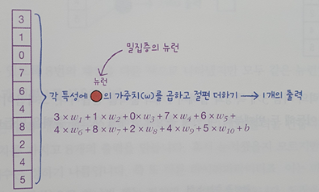
    - 반면 합성곱은 입력 데이터 전체에 가중치를 적용하는 것이 아니라 **입력의 일부**에만 가중치를 곱한다.
    1. 예를 들어 총 10개의 입력 특성 중 뉴런이 3개의 가중치를 가진다고 가정한다.
    2. 가중치 $w_1 \sim w_3$이 처음 3개 특성과 곱해지고 절편 $b$가 더해져 1개의 출력을 만든다.
    3. 이 뉴런이 한 칸 아래(또는 옆)로 이동해 두 번째부터 네 번째 특성과 곱해져 새로운 출력을 만든다.
    4. 여기서 중요한 점은 첫 번째 합성곱에 쓰인 가중치 $w_1 \sim w_3$과 절편 $b$가 이동한 뒤의 합성곱에도 **동일하게 재사용(가중치 공유)**된다는 것이다.
- 이렇게 한 칸씩 이동하면서 출력을 만드는 연산이 **합성곱**이다. 입력이 10개이고 가중치가 3개라면 총 8번 이동할 수 있으므로 8개의 출력이 만들어진다.
- 합성곱 층의 뉴런에 있는 가중치 개수는 정하기 나름이므로 또 다른 **하이퍼파라미터**이다.

#### 필터(Filter)와 커널(Kernel)

- **필터(Filter):** 합성곱 신경망에서 뉴런을 부르는 또 다른 이름이며, **커널(Kernel)** 이라고도 부른다. (케라스에서는 뉴런 개수를 이야기할 때 필터라 부르고, 입력에 곱해지는 가중치 행렬을 의미할 때 커널이라 부른다.)
- 입력이 2차원 배열이면 필터(커널)도 2차원이어야 한다.
- 입력 크기를 $(4, 4)$, 커널 크기를 $(3, 3)$으로 가정한다. (커널 크기는 하이퍼파라미터이다.)
    1. 왼쪽 위 모서리에서부터 합성곱을 시작한다.
    2. 필터가 오른쪽으로 한 칸 이동하여 합성곱을 수행한다. (입력의 너비가 4이므로 더 이상 오른쪽으로 이동할 수 없다.)
    3. 아래로 한 칸 이동한 다음 다시 왼쪽에서부터 오른쪽으로 합성곱을 수행한다.

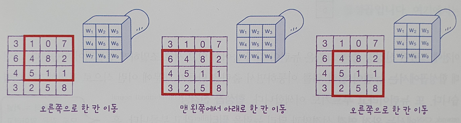

- 필터는 총 4번 이동할 수 있기 때문에 4개의 출력을 만든다.

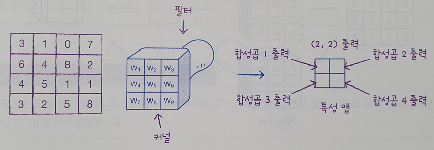

- 이때 4개의 출력을 필터가 입력에 놓인 위치에 맞게 $(2, 2)$ 크기의 2차원으로 배치한다. (왼쪽 위, 오른쪽 위, 왼쪽 아래, 오른쪽 아래 총 4개의 위치에 해당 값을 놓는다.)
- 합성곱 계산을 통해 얻은 2차원 출력을 특별히 **특성 맵(Feature Map)** 이라고 부른다.

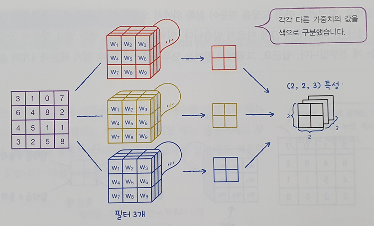

#### 케라스 합성곱 층

- 밀집층과 마찬가지로 합성곱 층에서도 가중치와 절편을 계산한 후 **활성화 함수**를 적용하며, 특성 맵은 활성화 함수를 적용한 후의 결과이다.
- **합성곱 신경망(CNN):** 일반적으로 1개 이상의 합성곱 층을 사용한 인공 신경망을 합성곱 신경망이라고 부른다. 즉, 합성곱 층만 사용한 신경망만을 의미하는 것이 아니라 합성곱 층과 밀집층이 함께 결합된 전체 네트워크를 뜻한다.

```python
import keras

# 10개의 필터, (3, 3) 크기의 커널, 렐루 활성화 함수를 사용하는 합성곱 층
keras.layers.Conv2D(10, kernel_size=(3, 3), activation='relu')
```

#### 패딩(Padding)과 스트라이드(Stride)

만약 커널 크기는 $(3, 3)$으로 그대로 두고 출력의 크기를 입력과 동일하게 $(4, 4)$로 만들려면 마치 더 큰 입력에 합성곱하는 것처럼 다루어야 한다.

- 실제 입력 크기는 $(4, 4)$이지만 주변에 1픽셀씩을 둘러 $(6, 6)$처럼 다룬다고 가정한다.
- $(6, 6)$ 크기의 입력에 $(3, 3)$ 크기의 커널로 합성곱을 수행하면 가로 4번, 세로 4번 이동할 수 있으므로 출력(특성 맵)의 크기는 입력과 동일한 $(4, 4)$가 된다.

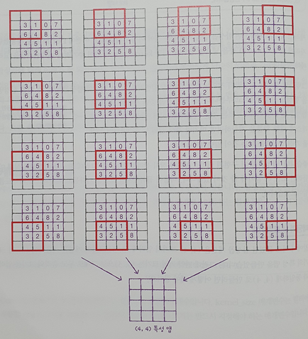

- 이렇게 입력 배열의 주위를 가상의 원소로 채우는 것을 **패딩(Padding)** 이라고 한다.
- 실제 입력값이 아니기 때문에 패딩은 `0`으로 채운다(Zero-padding). 실제 값이 0으로 채워져 있기 때문에 합성곱의 곱셈 계산 결과에는 영향을 미치지 않으며, 순전히 커널이 도장을 찍을 횟수를 늘려주는 역할만 한다.
- **세임 패딩(Same Padding):** 입력과 특성 맵의 가로세로 크기를 동일하게 만들기 위해 입력 주위에 적절히 0으로 패딩하는 방식이다. 합성곱 신경망에서 가장 많이 사용된다.
- **밸리드 패딩(Valid Padding):** 패딩 없이 순수한 입력 배열에서만 합성곱을 하여 특성 맵을 만드는 경우이다. 밸리드 패딩을 사용하면 특성 맵의 크기가 입력보다 줄어들 수밖에 없다.
- **합성곱에서 패딩을 사용하는 이유:**
    1. 패딩을 하지 않으면 합성곱 층을 통과할 때마다 특성 맵의 크기가 계속 작아진다.
    2. 패딩 없이 합성곱을 하면 입력 배열의 모서리(가장자리) 픽셀들은 중앙 픽셀에 비해 커널과 연산되는 횟수가 현저히 적다. 패딩을 적용하면 모서리에 있는 중요한 정보도 특성 맵으로 골고루 잘 전달될 수 있다.
- **스트라이드(Stride):** 합성곱 연산에서 필터가 이동하는 크기(보폭)를 의미한다. 기본값은 1(한 칸씩 이동)이며, 튜플 `(1, 1)`처럼 아래와 오른쪽으로 이동하는 크기를 각각 지정할 수도 있다.

```python
# 세임 패딩과 스트라이드 지정 예시
keras.layers.Conv2D(10, kernel_size=(3, 3), activation='relu', padding='same', strides=1)
```

#### 풀링 (Pooling)

- 풀링은 합성곱 층에서 만든 특성 맵의 **가로세로 크기를 줄이는 역할**을 수행한다. 단, **특성 맵의 개수(깊이/채널)는 줄이지 않고 그대로 유지**한다.

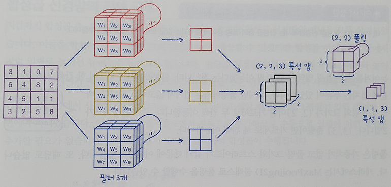

- 풀링에도 커널처럼 도장을 찍는 영역 크기가 있지만, 가중치가 없으며 도장을 찍은 영역에서 가장 큰 값을 고르거나 평균값을 계산한다.
    - **최대 풀링(Max Pooling):** 도장을 찍은 영역에서 가장 큰 값을 선택한다.
    - **평균 풀링(Average Pooling):** 도장을 찍은 영역의 평균값을 계산한다.
- 주의할 점은 합성곱에서는 커널이 한 칸씩 겹치며 이동(스트라이드=1)했지만, **풀링에서는 영역이 겹치지 않고 이동**한다. 따라서 풀링의 크기가 $(2, 2)$이면 가로세로로 2칸씩 이동하므로 스트라이드가 자동으로 2가 된다.

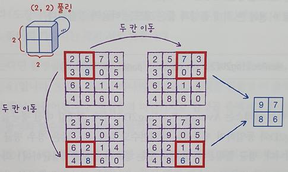

- 위 그림처럼 $(4, 4)$ 특성 맵에 $(2, 2)$ 최대 풀링을 적용하면 첫 번째 영역에서 `9`, 그다음 영역들에서 차례대로 `7`, `8`, `6`을 골라 절반으로 줄어든 $(2, 2)$ 크기의 출력을 만든다.
- 케라스에서는 `MaxPool2D`(또는 `MaxPooling2D`) 클래스의 첫 번째 매개변수로 풀링의 크기를 지정한다. 대부분 풀링의 크기는 `2`로 지정하여 가로세로 크기를 절반으로 줄인다. 만약 `(2, 3)`으로 지정하면 높이 방향으로 두 칸, 너비 방향으로 세 칸씩 묶어 풀링을 수행한다.

```python
# (2, 2) 크기의 최대 풀링 수행 (strides 기본값은 풀링 크기와 동일, padding 기본값은 'valid')
keras.layers.MaxPool2D(2)
keras.layers.MaxPool2D(2, strides=2, padding='valid')
```


#### 합성곱 신경망의 전체 구조

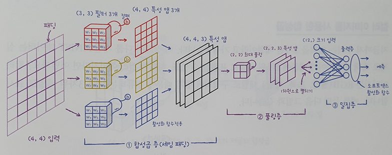

1. 입력 이미지 크기는 $(4, 4)$이고 세임 패딩을 적용해 $(6, 6)$이 된다. 합성곱 층의 필터는 총 3개이다.
2. 각 필터는 $(3, 3)$ 크기의 가중치를 가지고 있으며, 필터마다 절편($b$)이 하나씩 있다.
3. 따로 언급하지 않는다면 합성곱의 스트라이드는 항상 1이다. 따라서 필터 1개가 만드는 특성 맵의 크기는 입력과 동일한 $(4, 4)$이다.
4. 3개의 필터가 각각 $(4, 4)$ 크기의 특성 맵을 하나씩 만들고, 이 3개가 깊이 방향으로 합쳐져서 $(4, 4, 3)$ 크기의 3차원 특성 맵이 만들어진다. (활성화 함수인 ReLU가 적용된다.)
5. 풀링 층은 합성곱 층에서 만든 특성 맵의 가로세로 크기를 줄인다. $(2, 2)$ 최대 풀링을 사용해 가로세로를 절반으로 줄인다. 특성 맵의 개수는 변하지 않으므로 $(4, 4, 3)$에서 $(2, 2, 3)$으로 크기가 줄어든다.
    - *풀링을 사용하는 이유:* 합성곱에서 스트라이드를 크게 하여 특성 맵을 줄이는 것보다, 풀링 층에서 크기를 줄이는 것이 경험적으로 더 나은 성능을 내기 때문이다. 또한 최대 풀링은 특성 맵에서 가장 강하게 활성화된(중요한) 신호만 남기는 효과가 있다.
6. 밀집층인 출력층에 전달하려면 $(2, 2, 3)$인 3차원 배열을 1차원으로 펼쳐야 한다(`Flatten`). 펼친 배열은 $2 \times 2 \times 3 = 12$개의 원소를 가진 1차원 배열이 되며, 이것이 출력층(예: 3개의 클래스를 분류하는 소프트맥스 층)의 입력이 된다.

#### 컬러 이미지를 사용한 합성곱

- 흑백 이미지는 2차원 배열로 표현할 수 있지만, 컬러 이미지는 **RGB(빨강, 초록, 파랑)** 채널로 구성되어 있기 때문에 컴퓨터는 이를 $(높이, 너비, 3)$ 크기의 **3차원 배열**로 표시한다.
- 깊이가 있는 3차원 입력에서 합성곱을 수행하려면 **필터의 커널 크기도 똑같이 3차원**이어야 한다. 예를 들어 입력이 $(4, 4, 3)$이고 커널의 가로세로 크기를 $(3, 3)$으로 지정하면, 필터 1개의 실제 커널 크기는 입력의 깊이(채널 수)와 동일한 **$(3, 3, 3)$** 이 된다.
- 이때 $(3, 3, 3)$ 크기의 필터 1개는 총 $3 \times 3 \times 3 = 27$개의 가중치를 곱하고 절편 1개를 더해 **단 1개의 출력 값**을 만든다. 즉, 입력이나 필터의 차원이 몇 차원이든 상관없이 **필터 1개가 만들어내는 특성 맵의 깊이는 항상 1**이며, 최종 특성 맵의 깊이는 오직 **사용한 필터의 개수**에 의해서만 결정된다.
- 케라스의 합성곱 층은 항상 이처럼 깊이(채널) 차원이 있는 **3차원 입력**을 기대한다. 따라서 패션 MNIST 같은 흑백 이미지도 $(28, 28)$이 아니라 깊이 차원 1을 추가하여 **$(28, 28, 1)$** 크기로 변환해서 전달해야 한다.

---

### 2. 합성곱 신경망을 사용한 이미지 분류

#### 데이터 준비 및 전처리

패션 MNIST 데이터를 불러와 채널 차원을 추가하고 0~1 사이로 정규화한 뒤, 훈련 세트와 검증 세트로 나눈다.

```python
import keras
from sklearn.model_selection import train_test_split

(train_input, train_target), (test_input, test_target) = keras.datasets.fashion_mnist.load_data()

# 흑백 이미지에 깊이(채널) 차원을 추가하여 (28, 28) -> (28, 28, 1)로 변환 후 정규화
train_scaled = train_input.reshape(-1, 28, 28, 1) / 255.0

train_scaled, val_scaled, train_target, val_target = train_test_split(
    train_scaled, train_target, test_size=0.2, random_state=42
)
```

#### 합성곱 신경망 만들기

- `Conv2D`: 입력의 너비와 높이 방향의 합성곱 연산을 구현한 클래스이다. 첫 번째 매개변수는 필터의 개수이고, `kernel_size`로 커널의 크기를 지정한다.
- `MaxPool2D` (`MaxPooling2D`): 입력의 너비와 높이를 줄이는 풀링 연산을 구현한 클래스이다. 첫 번째 매개변수로 풀링의 크기를 지정한다(가로세로 크기가 같은 경우 정수 하나로, 다른 경우 `(높이, 너비)`로 구성된 정수 튜플을 지정할 수 있다).

```python
model = keras.Sequential()
model.add(keras.layers.Input(shape=(28, 28, 1)))

# 첫 번째 합성곱-풀링 층
model.add(keras.layers.Conv2D(32, kernel_size=3, activation='relu', padding='same'))
model.add(keras.layers.MaxPool2D(2))
# 패션 MNIST 이미지가 (28, 28) 크기에 세임 패딩을 적용했기 때문에 합성곱 층에서 출력된 특성 맵의 가로세로 크기는 동일하다.
# 이어서 (2, 2) 풀링을 적용했으므로 특성 맵의 크기는 절반으로 줄어든다.
# 합성곱 층에서 32개의 필터를 사용했기 때문에 특성 맵의 깊이는 32가 된다.
# 따라서 첫 번째 최대 풀링을 통과한 특성 맵의 크기는 (14, 14, 32)가 될 것이다.

# 필터의 개수를 64개로 늘린 두 번째 합성곱-풀링 층
model.add(keras.layers.Conv2D(64, kernel_size=3, activation='relu', padding='same'))
model.add(keras.layers.MaxPool2D(2))
# 세임 패딩과 (2, 2) 풀링을 거치며 가로세로 크기는 다시 절반으로 줄어들고,
# 64개의 필터를 사용했으므로 최종적으로 만들어지는 특성 맵의 크기는 (7, 7, 64)가 될 것이다.

# 마지막 10개의 뉴런을 가진 (밀집) 출력층에서 확률을 계산하기 위해 3차원 특성 맵을 일렬로 펼치기
# Flatten -> Dense -> Dropout -> Dense
model.add(keras.layers.Flatten())
model.add(keras.layers.Dense(100, activation='relu'))
model.add(keras.layers.Dropout(0.4))
model.add(keras.layers.Dense(10, activation='softmax'))
# 은닉층과 출력층 사이에 드롭아웃을 넣어 은닉층의 과대적합을 막아 성능을 조금 더 개선해 줄 것이다.

model.summary()
```

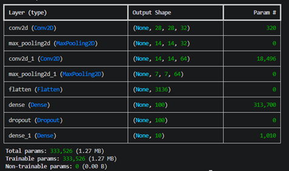

- **모델 파라미터 개수 계산 검증:**
    - 첫 번째 `Conv2D`: $(3 \times 3 \times 1)$ 크기 커널 $\times 32$개 필터 $+ 32$개 절편 $= 320$개
    - 두 번째 `Conv2D`: $(3 \times 3 \times 32)$ 크기 커널 $\times 64$개 필터 $+ 64$개 절편 $= 18,496$개
    - `Flatten`: $(7, 7, 64)$ 크기를 1차원으로 펼치므로 $7 \times 7 \times 64 = 3,136$개의 출력 뉴런 생성 (가중치 없음)
    - 첫 번째 `Dense` (은닉층): $3,136$개 입력 $\times 100$개 뉴런 $+ 100$개 절편 $= 313,700$개
    - 두 번째 `Dense` (출력층): $100$개 입력 $\times 10$개 뉴런 $+ 10$개 절편 $= 1,010$개

- `keras.utils.plot_model()` 함수를 사용하면 층의 구성을 그림으로 시각화할 수 있다. (실행을 위해 `pydot`과 `graphviz` 설치가 필요하다.)

```bash
pip install pydot graphviz
conda install -c conda-forge graphviz
```

```python
keras.utils.plot_model(model)
```

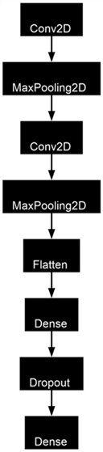

- `show_shapes=True` 매개변수를 지정하면 각 층의 입력과 출력의 크기를 함께 표시해 준다. (`to_file` 매개변수로 파일 이름을 지정하면 원하는 이름으로 이미지를 저장할 수 있다.)

```python
keras.utils.plot_model(model, show_shapes=True)
```

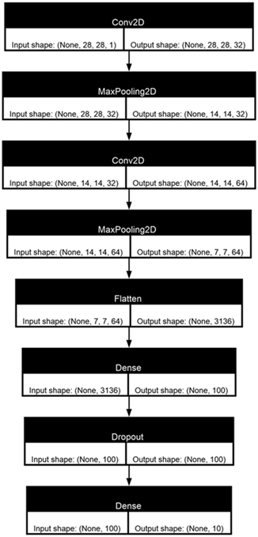

#### 모델 컴파일과 훈련

Adam 옵티마이저를 사용하고, `ModelCheckpoint` 콜백과 `EarlyStopping` 콜백을 함께 사용하여 조기 종료 기법을 구현한다.

```python
model.compile(optimizer='adam', loss='sparse_categorical_crossentropy', 
              metrics=['accuracy'])

checkpoint_cb = keras.callbacks.ModelCheckpoint('best-cnn-model.keras', 
                                                save_best_only=True)
early_stopping_cb = keras.callbacks.EarlyStopping(patience=2, 
                                                  restore_best_weights=True)

history = model.fit(train_scaled, train_target, epochs=20, 
                    validation_data=(val_scaled, val_target), 
                    callbacks=[checkpoint_cb, early_stopping_cb])
```

```text
Epoch 1/20
1500/1500 ━━━━━━━━━━━━━━━━━━━━ 11s 7ms/step - accuracy: 0.8099 - loss: 0.5291 - val_accuracy: 0.8726 - val_loss: 0.3380
Epoch 2/20
1500/1500 ━━━━━━━━━━━━━━━━━━━━ 12s 8ms/step - accuracy: 0.8714 - loss: 0.3570 - val_accuracy: 0.8866 - val_loss: 0.3029
Epoch 3/20
1500/1500 ━━━━━━━━━━━━━━━━━━━━ 12s 8ms/step - accuracy: 0.8901 - loss: 0.3055 - val_accuracy: 0.9048 - val_loss: 0.2565
Epoch 4/20
1500/1500 ━━━━━━━━━━━━━━━━━━━━ 12s 8ms/step - accuracy: 0.9010 - loss: 0.2731 - val_accuracy: 0.9060 - val_loss: 0.2549
Epoch 5/20
1500/1500 ━━━━━━━━━━━━━━━━━━━━ 12s 8ms/step - accuracy: 0.9096 - loss: 0.2495 - val_accuracy: 0.9130 - val_loss: 0.2368
Epoch 6/20
1500/1500 ━━━━━━━━━━━━━━━━━━━━ 12s 8ms/step - accuracy: 0.9159 - loss: 0.2292 - val_accuracy: 0.9120 - val_loss: 0.2375
Epoch 7/20
1500/1500 ━━━━━━━━━━━━━━━━━━━━ 12s 8ms/step - accuracy: 0.9204 - loss: 0.2118 - val_accuracy: 0.9149 - val_loss: 0.2372
```

- 조기 종료가 잘 이루어졌는지 확인하기 위해 훈련 손실과 검증 손실 그래프를 그려본다.

```python
import matplotlib.pyplot as plt

plt.plot(history.history['loss'])
plt.plot(history.history['val_loss'])
plt.xlabel('epoch')
plt.ylabel('loss')
plt.legend(['train', 'val'])
plt.show()
```

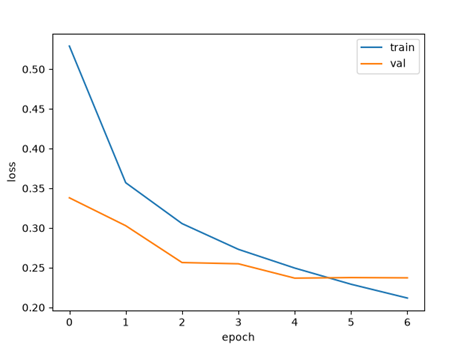

- 검증 세트에 대한 손실이 감소하다가 정체되기 시작하는 시점(5번째 에포크, 그래프상 인덱스 4)이 최상의 모델이며, `restore_best_weights=True`를 지정했으므로 `model` 객체에는 최적의 가중치가 복원되어 있다.

#### 모델 평가 및 새로운 데이터 예측

- 검증 세트의 첫 번째 샘플이 어떤 이미지인지 먼저 확인한다. `imshow()`로 흑백 이미지를 그릴 때는 `(28, 28, 1)` 크기를 2차원인 `(28, 28)`로 바꾸어 주어야 한다.

```python
plt.imshow(val_scaled[0].reshape(28, 28), cmap='gray_r')
plt.show()
```

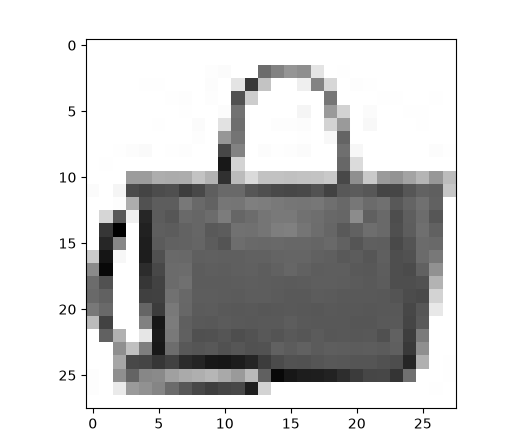

- `predict()` 메서드를 사용해 이 샘플에 대한 10개 클래스의 예측 확률을 출력하고 막대그래프로 표현한다.
- *주의:* `predict()`나 `evaluate()` 같은 메서드는 모두 입력의 첫 번째 차원이 **배치 차원**일 것으로 기대한다. 따라서 샘플 하나를 전달할 때 `val_scaled[0]`이 아니라 슬라이싱 연산자 `val_scaled[0:1]`을 사용해 `(1, 28, 28, 1)` 크기로 전달해야 한다.

```python
preds = model.predict(val_scaled[0:1])
print(preds)

plt.bar(range(1, 11), preds[0])
plt.xlabel('class')
plt.ylabel('prob.')
plt.show()
```

```text
[[4.1355988e-11 1.2796395e-15 2.8405683e-12 3.7846372e-11 9.0191792e-13
  9.8000592e-12 5.5741583e-12 4.3405252e-10 1.0000000e+00 7.9640634e-12]]
```

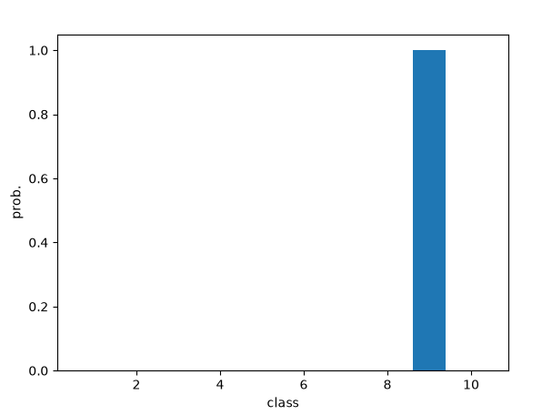

- 9번째 클래스(인덱스 8, 가방)의 확률이 사실상 1에 가깝고 다른 클래스들은 0에 가까우므로 가방이라고 강하게 예측한다.
- 마지막으로 테스트 세트를 이용해 합성곱 신경망의 일반화 성능을 측정한다.

```python
# 픽셀값의 범위를 0~1 사이로 바꾸고 채널 차원을 추가하기 위해 이미지 크기를 (28, 28, 1)로 바꾼다.
test_scaled = test_input.reshape(-1, 28, 28, 1) / 255.0
model.evaluate(test_scaled, test_target)
```

```text
313/313 ━━━━━━━━━━━━━━━━━━━━ 1s 3ms/step - accuracy: 0.9154 - loss: 0.2377
```

- 테스트 세트에서의 점수는 검증 세트보다 조금 더 작지만, 실전에 투입했을 때 약 91%의 분류 성능을 기대할 수 있다.

---

### 3. 합성곱 신경망의 시각화

#### 가중치 시각화

- 합성곱 층은 여러 개의 필터를 사용해 이미지에서 특징을 학습한다.
- 각 필터는 커널이라 부르는 가중치와 절편을 가지고 있다.
- 가중치는 입력 이미지의 2차원 영역에 적용되어 어떤 특징을 크게 두드러지게 표현하는 역할을 한다.
- 이전 절에서 만든 모델이 어떤 가중치를 학습했는지 확인하기 위해 저장해 둔 체크포인트 파일을 읽어 들인다.

```python
# 체크포인트 파일 읽어오기
model = keras.models.load_model('best-cnn-model.keras')
```

- 케라스 모델에 추가한 층은 `model.layers` 속성에 파이썬 리스트로 저장되어 있다. 이전 절에서 추가했던 `Conv2D`, `MaxPooling2D` 층이 번갈아 2번 연속 등장하는 것을 볼 수 있다.

```python
print(model.layers)
```

```text
[<Conv2D name=conv2d, built=True>, 
 <MaxPooling2D name=max_pooling2d, built=True>, 
 <Conv2D name=conv2d_1, built=True>, 
 <MaxPooling2D name=max_pooling2d_1, built=True>, 
 <Flatten name=flatten, built=True>, 
 <Dense name=dense, built=True>, 
 <Dropout name=dropout, built=True>, 
 <Dense name=dense_1, built=True>]
```

- **첫 번째 합성곱 층의 가중치 조사:**
    - `layers` 속성의 첫 번째 원소(`model.layers[0]`)를 선택해 `weights`의 첫 번째 원소(가중치)와 두 번째 원소(절편)의 크기를 출력한다.
    - 이전 절에서 커널 크기를 `(3, 3)`으로 지정했고 이 합성곱 층에 전달되는 입력의 깊이가 `1`이므로 실제 커널 하나의 크기는 `(3, 3, 1)`이다.
    - 또한 필터의 개수가 32개이므로 `weights`의 첫 번째 원소인 가중치의 크기는 `(3, 3, 1, 32)`가 된다.
    - `weights`의 두 번째 원소는 절편의 개수를 나타내는데 필터마다 1개의 절편이 있으므로 `(32,)` 크기가 된다.

```python
conv = model.layers[0]
print(conv.weights[0].shape, conv.weights[1].shape)
# 출력 : (3, 3, 1, 32) (32,)
```

- `weights` 속성은 텐서플로의 다차원 배열인 `Tensor` 클래스의 객체이다.
- 다루기 쉽도록 `numpy()` 메서드를 사용해 넘파이 배열로 변환한 뒤, 가중치 배열의 평균과 표준편차를 `mean()` 메서드와 `std()` 메서드로 계산하고 히스토그램으로 분포를 확인한다.

```python
conv_weights = conv.weights[0].numpy()
print(conv_weights.mean(), conv_weights.std())
# 출력 : -0.0326425 0.22553095

plt.hist(conv_weights.reshape(-1, 1))
plt.xlabel('weight')
plt.ylabel('count')
plt.show()
```

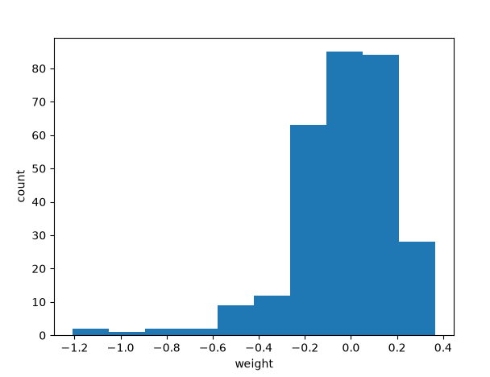

- 히스토그램을 보면 가중치들이 0을 중심으로 종 모양의 분포를 띠고 있는 것을 알 수 있다. (맷플롯립의 `hist()` 함수에는 1차원 배열을 전달해야 하므로 `reshape(-1, 1)`로 1열로 펼쳤다.)
- 이번에는 32개의 커널을 16개씩 두 줄로 출력해 본다. 맷플롯립의 `subplots()` 함수를 사용해 32개의 그래프 영역을 만들고 순서대로 커널을 출력한다.
- 이때 `vmin`과 `vmax`로 컬러맵으로 표현할 색상의 최소/최대 기준값을 `-0.5`와 `0.5`로 고정하여 모든 필터의 가중치 색상을 동일한 기준으로 비교할 수 있게 한다.

```python
fig, axs = plt.subplots(2, 16, figsize=(15, 2))
for i in range(2):
    for j in range(16):
        axs[i, j].imshow(conv_weights[:, :, 0, i * 16 + j], vmin=-0.5, vmax=0.5)
        axs[i, j].axis('off')
plt.show()
```

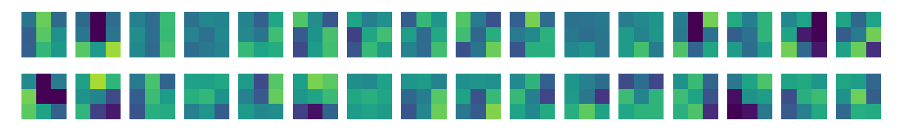

- 결과 그래프를 보면 이 가중치 값이 무작위로 나열된 것이 아닌 **어떤 패턴**을 띠고 있음을 볼 수 있다. 밝은 노란색/연두색 부분은 가중치 값이 높은 양수(+)인 부분이다.
- 예를 들어 오른쪽 열이나 위아래 행이 유독 밝은 가중치들은 각각 수직 경계선이나 수평 경계선(직선)을 만나면 크게 활성화될 것이다.

#### 훈련하지 않은 빈 합성곱 신경망과의 가중치 비교

훈련을 거친 가중치가 훈련하지 않은 초기 가중치와 어떻게 다른지 그림으로 비교하기 위해 빈 합성곱 신경망을 만든다.

```python
no_training_model = keras.Sequential()
no_training_model.add(keras.layers.Input(shape=(28, 28, 1)))
no_training_model.add(keras.layers.Conv2D(32, kernel_size=3, activation='relu', padding='same'))

no_training_conv = no_training_model.layers[0]
print(no_training_conv.weights[0].shape)
# 출력 : (3, 3, 1, 32)
```

- 동일하게 `(3, 3)` 커널을 가진 필터를 32개 사용했기 때문에 이 가중치의 크기도 앞서 그래프로 출력한 가중치와 같은 `(3, 3, 1, 32)`이다.
- 이 가중치의 평균과 표준편차를 확인하고 히스토그램을 그려본다.

```python
no_training_weights = no_training_conv.weights[0].numpy()
print(no_training_weights.mean(), no_training_weights.std())
# 출력 : 0.004582799 0.08043564

plt.hist(no_training_weights.reshape(-1, 1))
plt.xlabel('weight')
plt.ylabel('count')
plt.show()
```

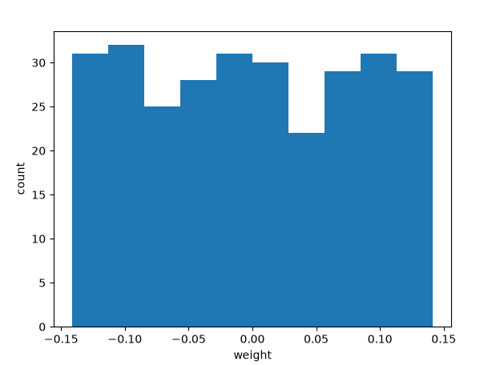

- 평균은 이전과 동일하게 0에 가깝지만 표준편차는 이전과 달리 매우 작다.
- 히스토그램을 보면 대부분의 가중치가 `-0.15 ~ 0.15` 사이에 있고 비교적 고른 분포를 보인다. 이는 케라스가 신경망의 가중치를 처음 초기화할 때 균등 분포(Glorot uniform)에서 랜덤하게 선택하기 때문이다.
- 이 가중치 값을 앞서 훈련된 가중치와 동일한 스케일(`vmin=-0.5, vmax=0.5`)로 그림으로 출력한다.

```python
fig, axs = plt.subplots(2, 16, figsize=(15, 2))
for i in range(2):
    for j in range(16):
        axs[i, j].imshow(no_training_weights[:, :, 0, i * 16 + j], vmin=-0.5, vmax=0.5)
        axs[i, j].axis('off')
plt.show()
```

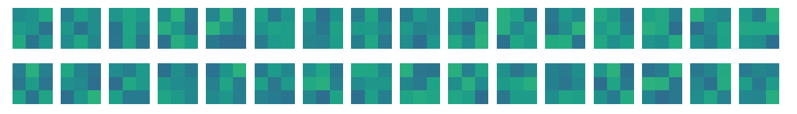

- 훈련된 모델과 달리 특징적인 패턴이 전혀 없으며 전체적으로 가중치가 밋밋하게 초기화되어 있다.

#### 함수형 API (Functional API)

- 지금까지 사용한 `Sequential` 클래스는 층을 차례대로 쌓은 모델을 만들 때 편리하지만, 입력이 2개이거나 출력이 2개인 복잡한 모델, 혹은 **중간 합성곱 층의 출력(특성 맵)을 가로채서 확인해야 하는 경우**에는 사용하기 어렵다. 이때는 케라스의 **함수형 API (`keras.Model`)**를 사용한다.
- 함수형 API에서는 케라스의 각 층 객체를 마치 파이썬 함수처럼 호출하여 입출력을 직접 연결한 뒤, 최종적으로 `keras.Model(입력, 출력)`에 전달해 모델을 완성한다.

```python
# 함수형 API 기본 사용 예시
inputs = keras.Input(shape=(784,))
dense1 = keras.layers.Dense(100, activation='sigmoid')
dense2 = keras.layers.Dense(10, activation='softmax')

# 층 객체를 함수처럼 호출할 수 있다.
hidden = dense1(inputs)
# 두 번째 층 호출: 첫 번째 층의 출력을 입력으로 전달
outputs = dense2(hidden)
# inputs와 outputs을 Model 클래스로 연결
func_model = keras.Model(inputs, outputs)
```

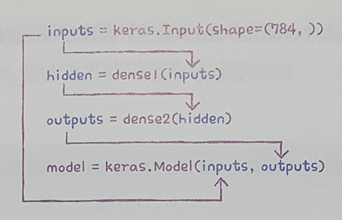

- 이제 우리가 학습시킨 `model` 객체의 층을 순서대로 나열해 보면 다음과 같다.

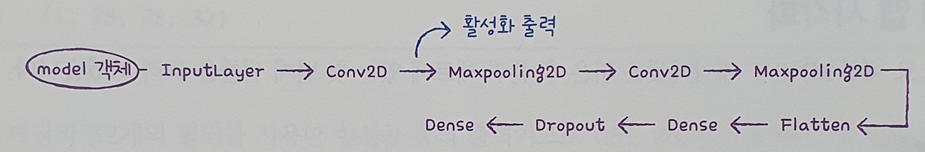

- 우리가 원하는 것은 첫 번째 `Conv2D` 층이 출력한 특성 맵이다. 따라서 `model` 객체의 **입력(`inputs`)**과 첫 번째 `Conv2D` 층의 **출력(`output`)**을 알 수 있다면, 이 둘을 `keras.Model`로 연결하여 특성 맵만 추출하는 새로운 모델을 얻을 수 있다.

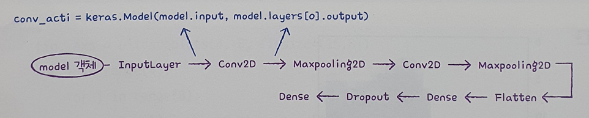

- `model` 객체의 입력은 `model.inputs` 속성으로 참조할 수 있고, 첫 번째 층의 출력은 `model.layers[0].output` 속성에서 얻을 수 있다.

```python
print(model.inputs)
# 출력 : [<KerasTensor shape=(None, 28, 28, 1), dtype=float32, sparse=False, ragged=False, name=input_layer>]

# model.inputs와 첫 번째 합성곱 층의 출력을 연결하는 새로운 conv_acti 모델 생성
conv_acti = keras.Model(model.inputs, model.layers[0].output)
```

- 이제 `conv_acti.predict()` 메서드를 호출하면 최종 클래스 확률이 아니라 **첫 번째 `Conv2D` 층이 만든 특성 맵**을 반환하게 된다.

#### 특성 맵 시각화

- 케라스로 패션 MNIST 데이터셋을 읽은 후 훈련 세트에 있는 첫 번째 샘플(앵클 부츠)을 그려본다.

```python
(train_input, train_target), (test_input, test_target) = keras.datasets.fashion_mnist.load_data()
plt.imshow(train_input[0], cmap='gray_r')
plt.show()
```

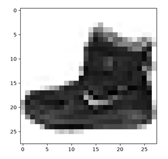

- 해당 샘플을 `conv_acti` 모델에 주입하여 첫 번째 `Conv2D` 층이 만드는 특성 맵을 추출한다.
- `predict()` 메서드는 항상 입력의 첫 번째 차원이 배치 차원일 것으로 기대하므로, 하나의 샘플을 전달하더라도 슬라이싱 연산자(`0:1`)를 사용해 첫 번째 차원을 유지한 채 `(1, 28, 28, 1)` 크기로 변경하고 255로 나눈다.

```python
ankle_boot = train_input[0:1].reshape(-1, 28, 28, 1) / 255.0
feature_maps = conv_acti.predict(ankle_boot)
print(feature_maps.shape)
# 출력 : (1, 28, 28, 32)
```

- 세임 패딩을 적용한 32개의 필터를 통과했으므로 특성 맵의 크기는 `(1, 28, 28, 32)`가 된다(첫 번째 차원은 배치 차원). 이 32개의 특성 맵을 4행 8열로 나누어 그려본다.

```python
fig, axs = plt.subplots(4, 8, figsize=(15, 8))
for i in range(4):
    for j in range(8):
        axs[i, j].imshow(feature_maps[0, :, :, i * 8 + j])
        axs[i, j].axis('off')
plt.show()
```

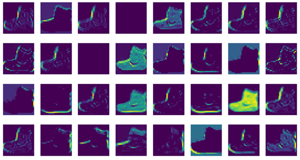

- 이 특성 맵들은 32개의 필터로 인해 입력 이미지(앵클 부츠)에서 강하게 활성화된 부분을 보여준다.
- 앞서 확인한 필터 가중치 이미지와 비교해 보면, 수직선이나 수평선 필터는 신발의 앞코나 발목 라인, 밑창 같은 윤곽선을 감지하고, 양수 가중치가 고르게 퍼진 필터는 신발의 전체적인 실루엣(내부 면적)을 감지하며, 음수 가중치가 많은 필터는 배경을 감지하거나 비활성화(단색 보라색)된 것을 확인할 수 있다.

- 이번에는 **두 번째 합성곱 층(`model.layers[2]`)이 만든 특성 맵**도 같은 방식으로 확인해 본다.

```python
conv2_acti = keras.Model(model.inputs, model.layers[2].output)
feature_maps = conv2_acti.predict(ankle_boot)
print(feature_maps.shape)
# 출력 : (1, 14, 14, 64)
```

- 첫 번째 풀링 층을 통과해 가로세로 크기가 절반인 `14`로 줄어들었고, 두 번째 합성곱 층의 필터 개수가 64개이므로 특성 맵의 크기는 `(1, 14, 14, 64)`이다. 64개의 특성 맵을 8개씩 8줄로 나누어 그려본다.

```python
fig, axs = plt.subplots(8, 8, figsize=(12, 12))
for i in range(8):
    for j in range(8):
        axs[i, j].imshow(feature_maps[0, :, :, i * 8 + j])
        axs[i, j].axis('off')
plt.show()
```

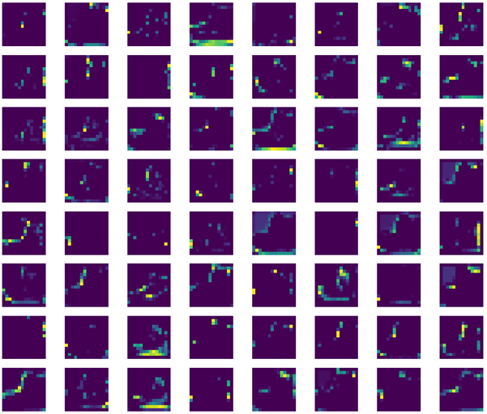

- 두 번째 합성곱 층의 필터 크기는 `(3, 3, 32)`이다. 두 번째 합성곱 층의 첫 번째 필터가 앞서 출력한 32개의 특성 맵과 모두 곱해져 두 번째 합성곱 층의 첫 번째 특성 맵 하나가 된다.
- 따라서 이렇게 계산된 출력은 `(14, 14, 32)` 특성 맵들이 조합된 결과이므로, 원본 이미지의 어떤 부위를 감지하는지 시각적으로 직관적인 이해를 하기가 어렵다.
- 이러한 현상은 합성곱 층을 많이 쌓을수록 심해진다. 즉, **합성곱 신경망의 앞부분에 있는 합성곱 층은 이미지의 시각적인 정보(윤곽선, 색상, 직선 등 저수준 특징)를 감지**하고, **뒤쪽에 있는 합성곱 층은 앞쪽에서 감지한 시각적인 정보를 바탕으로 추상적인 정보(고수준 특징)를 학습**한다고 볼 수 있다.