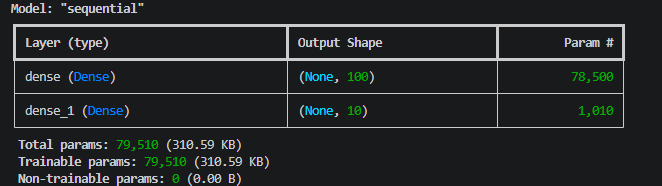
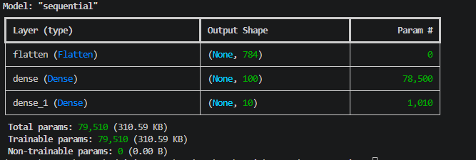
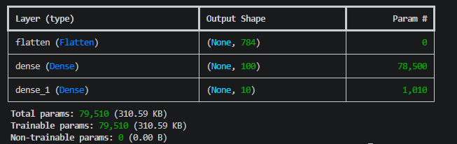
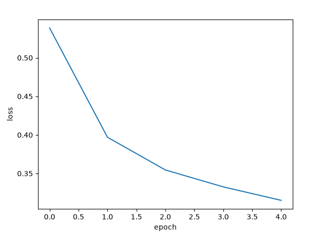
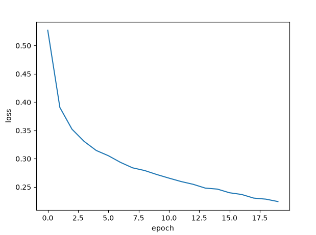
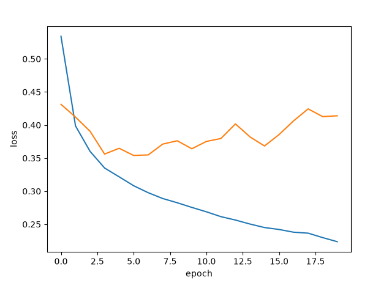
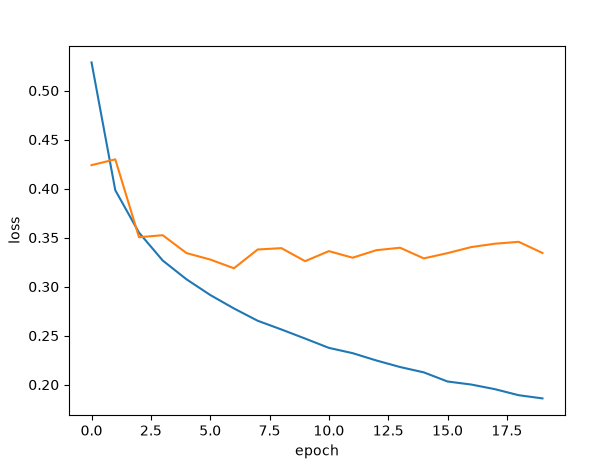
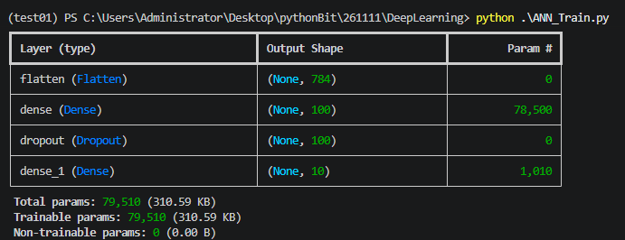
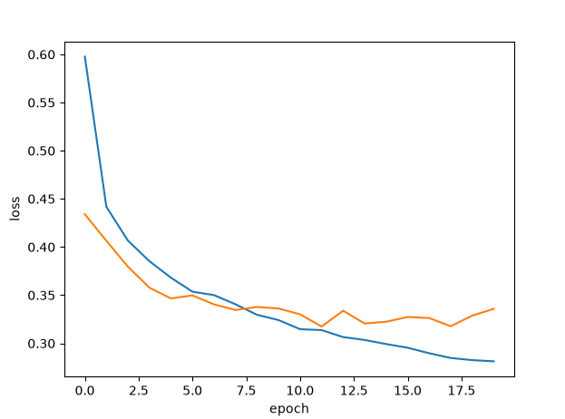
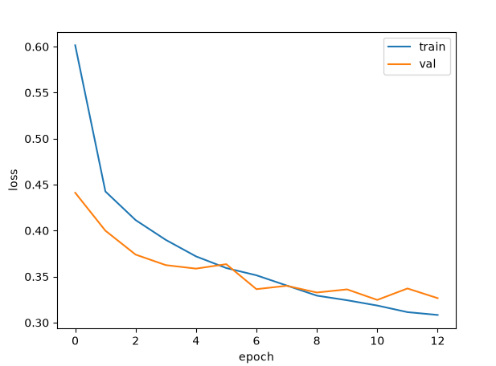

# DeepLearning

---

### ANN(인공신경망)

인공 신경망에서는 교차 검증을 잘 사용하지 않고 검증 세트를 별도로 덜어내어 사용합니다.

1. 딥러닝 분야의 데이터셋은 충분히 크기 때문에 검증 점수가 안정적이다.
2. 교차 검증을 수행하기에는 훈련 시간이 너무 오래 걸리기 때문이다.

- 활성화 함수
    - 소프트맥스와 같이 뉴런의 선형 방정식 계산 결과에 적용되는 함수
- 이진 분류
    - loss = 'binary_crossentropy'
- 다중 분류
    - loss = 'categorical_crossentropy'

이진 분류의 출력 뉴런은 오직 양성 클래스에 대한 확률($a$)만 출력하기 때문에 음성 클래스에 대한 확률은 $1-a$로 구할 수 있습니다.

역시 이진 분류의 타깃값은 양성 샘플일 경우에는 1, 음성 샘플일 경우에는 0으로 되어있다. 0을 곱하면 어떤 계산이든지 모두 0이 되기 때문에 특별히 음성 샘플일 경우 1로 바꾸어($1-\text{타깃값}$) 계산합니다.

이렇게 하면 하나의 뉴런만으로 양성과 음성 클래스에 대한 **크로스 엔트로피 손실**을 모두 계산할 수 있습니다.

- **밀집층**
    - 가장 간단한 인공 신경망의 층
    - 밀집층에서는 뉴런들이 모두 연결되어 있기 때문에 완전 연결 층이라고도 부릅니다.
    - 특별히 출력층에 밀집층을 사용할 때는 분류하려는 클래스와 동일한 개수의 뉴런을 사용합니다.
- **원-핫 인코딩**
    - 타깃값을 해당 클래스만 1이고 나머지는 모두 0인 배열로 만드는 것
    - 출력층이 10개인 패션 MNIST 데이터셋과 같은 다중 분류일 경우 이진 분류와 달리 각 클래스에 대한 확률이 모두 출력되기 때문에 타깃에 해당하는 확률만 남겨 놓기 위해서 나머지 확률에는 모두 0을 곱합니다.
    - $[a_0, a_1, a_2, a_3, a_4, a_5, a_6, a_7, a_8, a_9] \times [1, 0, 0, 0, 0, 0, 0, 0, 0, 0]$
    - 결국 신경망은 티셔츠 샘플에서 손실을 낮추려면 첫 번째 뉴런의 활성화 출력 $a_0$의 값을 가능한 1에 가깝게 만들어야 합니다.
    - compile() 메서드의 매개변수 metrics
    - 케라스 모델이 훈련할 때 기본으로 출력해주는 에포크마다의 손실값 외에 정확도를 함께 출력하기 위해 metrics 매개변수에 정확도 지표를 의미하는 'accuracy'를 지정
    - 케라스에서는 타깃값을 원-핫 인코딩으로 변환하지 않고 정수로 된 타깃값을 그대로 사용할 수 있도록 '**sparse_categorical_crossentropy**' 손실을 제공하므로 이런 변환을 수행할 필요가 없습니다.
- metrics 매개변수에는 여러 개의 지표를 지정할 수 있으며 하나의 지표를 지정할 때도 꼭 리스트로 전달해야 합니다.

```python
# 5번 반복에 정확도 약 85%
model.fit(train_scaled, train_target, epochs=5)
Epoch 1/5
1500/1500 ━━━━━━━━━━━━━━━━━━━━ 2s 770us/step - accuracy: 0.7935 - loss: 0.6118  
Epoch 2/5
1500/1500 ━━━━━━━━━━━━━━━━━━━━ 1s 785us/step - accuracy: 0.8392 - loss: 0.4748
Epoch 3/5
1500/1500 ━━━━━━━━━━━━━━━━━━━━ 1s 774us/step - accuracy: 0.8466 - loss: 0.4508
Epoch 4/5
1500/1500 ━━━━━━━━━━━━━━━━━━━━ 1s 770us/step - accuracy: 0.8513 - loss: 0.4376
Epoch 5/5
1500/1500 ━━━━━━━━━━━━━━━━━━━━ 1s 759us/step - accuracy: 0.8542 - loss: 0.4286
```

```python
# 검증 세트에서 모델의 성능 확인 : evaluate()
# 훈련 세트 점수보다 소폭 낮음
model.evaluate(val_scaled, val_target)
375/375 ━━━━━━━━━━━━━━━━━━━━ 0s 790us/step - accuracy: 0.8521 - loss: 0.4381
```

### DNN

- **은닉층**
    - 입력층과 출력층 사이에 있는 모든 층
    - 은닉층의 뉴런 개수는 적어도 출력층의 뉴런보다는 많게 만들어야 함.

#### 심층 신경망 만들기

- 인공 신경망의 강력한 성능은 층을 추가하여 입력 데이터에 대해 연속적인 학습을 진행하는 능력에서 나옵니다.
- Sequential

```python
# 클래스 객체를 만들 때 여러 개의 층을 리스트로 전달하여 필요한 층을 추가하면 된다.
model = keras.Sequential([inputs, dense1, dense2])
```

- model.summary()
    - 층에 대한 정보 보기



1. 첫 줄 : 모델의 이름
2. 그다음 입력층을 제외하고 이 모델에 들어 있는 층이 순서대로 나옵니다.
3. 층마다 층 이름, 클래스, 출력 크기, 모델 파라미터 개수가 출력됩니다.
4. 출력 크기
    1. None (배치 차원)
        1. 케라스 모델의 fit() 메서드에 훈련 데이터를 주입하면 이 데이터를 한 번에 모두 사용하지 않고 잘게 나누어 여러 번에 걸쳐 경사 하강법 단계를 수행합니다. (**미니 배치 경사 하강법**)
        2. 케라스의 기본 미니배치 크기는 32개입니다.
        3. 샘플 개수를 고정하지 않고 어떤 배치 크기에도 유연하게 대응할 수 있도록 None으로 설정
    2. 100 (뉴런 개수)

```python
model = keras.Sequential([inputs, dense1, dense2])
model.compile(loss='sparse_categorical_crossentropy', metrics=['accuracy'])
model.fit(train_scaled, train_target, epochs=5)

Epoch 1/5
1500/1500 ━━━━━━━━━━━━━━━━━━━━ 2s 1ms/step - accuracy: 0.8063 - loss: 0.5687    
Epoch 2/5
1500/1500 ━━━━━━━━━━━━━━━━━━━━ 2s 1ms/step - accuracy: 0.8512 - loss: 0.4123  
Epoch 3/5
1500/1500 ━━━━━━━━━━━━━━━━━━━━ 2s 1ms/step - accuracy: 0.8644 - loss: 0.3771  
Epoch 4/5
1500/1500 ━━━━━━━━━━━━━━━━━━━━ 2s 1ms/step - accuracy: 0.8732 - loss: 0.3536  
Epoch 5/5
1500/1500 ━━━━━━━━━━━━━━━━━━━━ 2s 1ms/step - accuracy: 0.8783 - loss: 0.3359  
```

층을 추가하여 성능을 향상시킨 것을 확인할 수 있습니다.

#### 렐루 함수(ReLU)

시그모이드 함수는 오른쪽과 왼쪽 끝으로 갈수록 그래프가 누워있기 때문에 올바른 출력을 만드는데 신속하게 대응하지 못합니다.

특히 층이 많은 심층 신경망일수록 그 효과가 누적되어 학습을 더 어렵게 만들어 이를 개선하기 위해 제안된 활성화 함수가 **렐루 함수**입니다.

- 입력이 양수일 경우 마치 활성화 함수가 없는 것처럼 그냥 입력을 통과시키고 음수일 경우에는 0으로 만듭니다.
- $\max(0, z)$
    - $z$가 0보다 크면 $z$를 출력하고 0보다 작으면 0을 출력합니다.
    - 특히 이미지 처리에서 좋은 성능을 낸다고 알려져 있습니다.

Flatten 클래스

- 배치 차원을 제외하고 나머지 입력 차원을 모두 일렬로 펼치는 역할

```python
model = keras.Sequential()
model.add(keras.layers.Input(shape=(28,28)))
model.add(keras.layers.Flatten())
model.add(keras.layers.Dense(100, activation='relu'))
model.add(keras.layers.Dense(10, activation='softmax'))
model.summary()
```

- Flatten 클래스에 포함된 모델 파라미터는 0개입니다.



- 시그모이드 함수를 사용했을 때와 비교하면 성능이 소폭 향상되었습니다.

```python
train_scaled = train_input / 255.0
train_scaled, val_scaled, train_target, val_target = train_test_split(
    train_scaled, train_target, test_size=0.2, random_state=42
)
model.compile(loss='sparse_categorical_crossentropy', metrics=['accuracy'])
model.fit(train_scaled, train_target, epochs=5)

Epoch 1/5
1500/1500 ━━━━━━━━━━━━━━━━━━━━ 2s 1ms/step - accuracy: 0.8133 - loss: 0.5322     
Epoch 2/5
1500/1500 ━━━━━━━━━━━━━━━━━━━━ 2s 1ms/step - accuracy: 0.8599 - loss: 0.3902  
Epoch 3/5
1500/1500 ━━━━━━━━━━━━━━━━━━━━ 2s 1ms/step - accuracy: 0.8745 - loss: 0.3499  
Epoch 4/5
1500/1500 ━━━━━━━━━━━━━━━━━━━━ 2s 1ms/step - accuracy: 0.8812 - loss: 0.3296  
Epoch 5/5
1500/1500 ━━━━━━━━━━━━━━━━━━━━ 2s 1ms/step - accuracy: 0.8885 - loss: 0.3119  
```

- 앞 절의 은닉층을 추가하지 않은 경우보다 몇 퍼센트 성능이 향상되었습니다.

```python
model.evaluate(val_scaled, val_target)
375/375 ━━━━━━━━━━━━━━━━━━━━ 0s 958us/step - accuracy: 0.8796 - loss: 0.3389
```

#### 옵티마이저

- 은닉층의 개수, 은닉층의 뉴런 개수, 활성화 함수, 층의 종류, 배치 크기, 에포크 매개변수 ⇒ 하이퍼파라미터
- 케라스가 제공하는 다양한 종류의 경사 하강법 알고리즘 ⇒ **옵티마이저**
- SGD(확률적 경사 하강법)
    - 가장 기본적인 옵티마이저
    - 1개의 샘플을 뽑아서 훈련하지 않고 기본적으로 미니배치를 사용하여 훈련합니다.
- SGD 클래스의 momentum 매개변수의 기본값은 0입니다. 이를 0보다 큰 값으로 지정하면 마치 이전의 그레이디언트를 가속도처럼 사용하는 **모멘텀 최적화**를 사용합니다.
- 보통 momentum 매개변수는 0.9 이상을 지정합니다.
- 다음처럼 SGD 클래스의 nesterov 매개변수를 기본값 False에서 True로 바꾸면 **네스테로프 모멘텀 최적화**를 사용합니다.

```python
sgd = keras.optimizers.SGD(momentum=0.9, nesterov=True)
```

- 네스테로프 모멘텀은 모멘텀 최적화를 2번 반복하여 구현합니다.
- 모델이 최적점에 가까이 갈수록 학습률을 낮추면 안정적으로 최적점에 수렴할 가능성이 높아지는데 이런 학습률을 **적응적 학습률**이라고 합니다.

#### Adagrad

- 그레이디언트 제곱을 누적하여 학습률을 나눕니다.
- 학습이 오래될수록 그레이디언트 제곱이 계속 누적되어 학습률이 0에 가까워져 학습이 멈추는 단점이 있습니다.

#### RMSprop

- Adagrad처럼 그레이디언트 제곱으로 학습률을 나누지만 최근의 그레이디언트를 사용하기 위해 지수 감소를 사용합니다.
- Adgrad의 단점을 해결하기 위해 최근 기울기만 반영하도록 개선한 것이 RMSprop입니다.

#### Adam

- 모멘텀 최적화와 RMSprop의 장점을 접목한 것

### 신경망 모델 훈련

#### 손실 곡선

케라스의 fit() 메서드는 History 클래스 객체를 반환합니다.

- History 객체에는 훈련 과정에서 계산한 지표, 즉 손실과 정확도 값이 저장되어 있습니다.

```python
def model_fn(a_layer=None):
    model = keras.Sequential()
    model.add(keras.layers.Input(shape=(28,28)))
    model.add(keras.layers.Flatten())
    model.add(keras.layers.Dense(100, activation='relu'))
    if a_layer:
        model.add(a_layer)
    model.add(keras.layers.Dense(10, activation='softmax'))
    return model

model = model_fn()
model.summary()
```



history 속성에 포함된 손실과 정확도

- 에포크마다 계산한 값이 순서대로 나열된 단순한 리스트



정확도


에포크 횟수를 20으로 늘리고 모델을 훈련한 손실 그래프



#### 검증 손실

에포크에 따른 과대적합과 과소적합 파악

- 훈련 세트에 대한 점수뿐만 아니라 검증 세트에 대한 점수도 필요
- validation_data 매개변수에 검증에 사용할 입력과 타깃값을 튜플로 만들어 전달
- 과대/과소적합 문제를 조사하기 위해 훈련 손실과 검증 손실을 한 그래프에 그려서 비교



검증 손실이 감소하다가 다시 증가 / 훈련 손실은 꾸준히 감소 ⇒ 전형적인 과대적합 모델

Adam

- 적응적 학습률을 사용해 에포크가 진행되면서 학습률의 크기를 조정할 수 있다.



#### 드롭아웃

- 은닉층에 있는 뉴런의 출력을 랜덤하게 꺼서 과대적합을 막는 기법이다.
    - 이전 층의 일부 뉴런이 랜덤하게 꺼지면 특정 뉴런에 과대하게 의존하는 것을 줄일 수 있고 모든 입력에 대해 주의를 기울여야 하기 때문에 과대적합을 막을 수 있다.
- 훈련 중에 적용되며 평가나 예측에서는 적용하지 않는다.



- 은닉층 뒤에 추가된 드롭아웃 층은 훈련되는 모델 파라미터가 없다.
- 일부 뉴런의 출력을 0으로 만들지만 전체 출력 배열의 크기를 바꾸지는 않는다.
- 케라스는 모델을 평가와 예측에 사용할 때는 자동으로 드롭아웃을 적용하지 않는다.
    
    
    
- 과대적합이 확실히 줄어든 모습 (epoch 11)

#### 모델 저장과 복원

- save() 메서드
    - .keras 확장자를 가진 파일에 모델 구조와 파라미터 등 필요한 정보를 모두 압축하여 저장
    
    ```python
    model.save('model-whole.keras')
    ```
    
- save_weights() 메서드
    - 훈련된 모델의 파라미터만 저장
    - 파라미터를 HDF5 포맷으로 저장, 파일 확장자는 .weights.h5로 끝난다.
    
    ```python
    model.save_weights('model.weights.h5')
    ```
    
- load_weights() 메서드
    - 훈련된 모델 파라미터 읽기
    - save_weights() 메서드로 저장했던 모델과 정확히 같은 구조를 가져야 한다.

#### 콜백

- 케라스 모델을 훈련하는 도중에 어떤 작업을 수행할 수 있도록 도와주는 도구이다.
    - ModelCheckpoint 콜백 (save_best_only=True)
        - 가장 낮은 검증 손실을 만드는 모델을 자동으로 저장
- 대표적으로 최상의 모델을 자동으로 저장해 주거나 검증 점수가 더 이상 향상되지 않으면 일찍 종료할 수 있다.
    - 조기 종료 (EarlyStopping 콜백)
        - 검증 손실이 더 이상 감소하지 않고 상승하여 과대적합이 일어나면 훈련을 계속 진행하지 않고 멈추는 기법 (patience 매개변수로 검증 손실이 향상되지 않더라도 참을 에포크 횟수를 지정하고, restore_best_weights=True로 가장 낮은 검증 손실을 낸 모델 파라미터로 되돌린다.)
            
            
            
- 에포크 인덱스 15 (16번째 에포크)에서 조기종료 (최상의 모델은 14번째 에포크인 인덱스 13)
