# RNN (순환 신경망)

---

### 1. 순차 데이터와 순환 신경망

#### 순차 데이터 (Sequential Data)

텍스트나 **시계열 데이터(time series data)**와 같이 순서에 의미가 있는 데이터를 말합니다.

- 텍스트 데이터는 단어의 순서가 중요한 대표적인 순차 데이터입니다.
- 순차 데이터를 다룰 때는 이전에 입력한 데이터를 기억하는 기능이 필요합니다.

**피드포워드 신경망 (Feedforward Neural Network)**

- 입력 데이터의 흐름이 앞으로만 전달되는 신경망입니다.
- 일반적인 머신러닝 모델에서는 샘플의 순서와 전혀 상관이 없었습니다. (심지어 데이터를 골고루 섞는 편이 성능에 더 좋았습니다.)
- 완전 연결 신경망(Dense)이나 합성곱 신경망(CNN)은 이전 입력 데이터를 기억하는 장치가 없습니다.
- 하나의 샘플(또는 하나의 배치)을 사용하여 정방향 계산을 수행하고 나면 그 샘플은 버려지고, 다음 샘플을 처리할 때 재사용하지 않습니다.

#### 순환 신경망 (Recurrent Neural Network, RNN)

완전 연결 신경망에 이전 데이터의 처리 결과가 순환되는 고리 하나만 추가하면 됩니다.

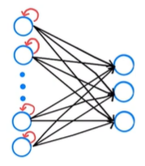

뉴런의 출력이 다시 자기 자신으로 전달됩니다.

- 어떤 샘플을 처리할 때 바로 이전에 사용했던 데이터를 재사용하는 셈입니다.

**타임스텝 (Timestep)**

샘플을 처리하는 한 단계를 타임스텝이라고 부릅니다.

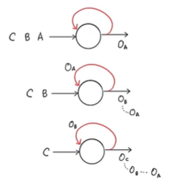

1. $O$는 출력된 결과입니다. 
2. 첫 번째 샘플 $A$를 처리하고 난 출력($O_A$)이 다시 뉴런으로 들어갑니다.
3. 두 번째 샘플 $B$를 처리할 때 앞에서 $A$를 사용해 만든 $O_A$를 함께 사용합니다.
    - 따라서 $O_A$와 $B$를 사용해서 만든 $O_B$에는 $A$에 대한 정보가 어느 정도 포함되어 있을 것입니다.
4. 세 번째 샘플 $C$를 처리할 때는 $O_B$를 함께 사용합니다.

순환 신경망에서는 층을 **셀(cell)**이라고 부릅니다. 한 셀에는 여러 개의 뉴런이 있지만, 완전 연결 신경망과 달리 뉴런을 모두 표시하지 않고 하나의 셀로 층을 표현합니다. 그리고 셀의 출력을 **은닉 상태(hidden state)**라고 부릅니다.

일반적으로 은닉층의 활성화 함수로는 **하이퍼볼릭 탄젠트(tanh) 함수**가 많이 사용됩니다.

- 시그모이드 함수와 달리 $-1 \sim 1$ 사이의 범위를 가집니다.

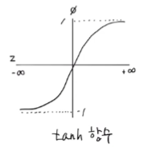

순환 신경망을 타임스텝마다 펼쳐서 그릴 수 있습니다.

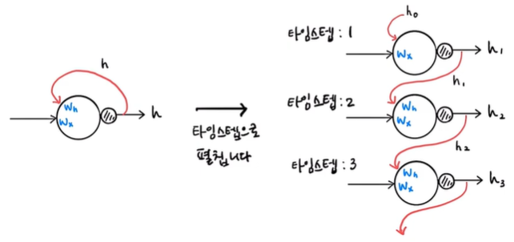

1. 타임스텝 1에서 셀의 출력 $h_1$이 타임스텝 2의 셀로 주입됩니다. 이때 가중치 $w_h$와 곱해집니다.
2. 타임스텝 2에서 셀의 출력 $h_2$가 타임스텝 3의 셀로 주입됩니다. 이때에도 가중치 $w_h$와 곱해집니다.
- 모든 타임스텝에서 사용되는 가중치 $w_h$는 단 하나라는 점이 중요합니다.
- 가중치 $w_h$는 타임스텝에 따라 변화하는 뉴런의 출력을 학습합니다.
- 맨 처음 타임스텝 1에서 사용되는 이전 은닉 상태 $h_0$은 이전 타임스텝이 없으므로 모두 $0$으로 초기화합니다.

#### 셀의 가중치와 입출력

순환 신경망의 셀에서 필요한 가중치 크기를 계산해 보겠습니다. 복잡한 모델을 배울수록 가중치 개수를 직접 계산해 보면 모델의 구조를 잘 이해하고 있는지 알 수 있습니다.

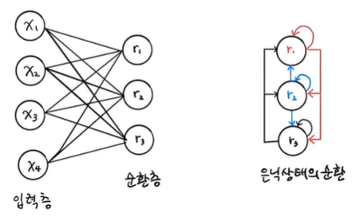

1. 입력층과 순환층의 뉴런이 모두 완전 연결되기 때문에 입력에 곱해지는 가중치 $w_x$의 크기는 $4 \times 3 = 12$가 됩니다.
2. 순환층에 있는 첫 번째 뉴런($r_1$)의 은닉 상태가 다음 타임스텝에 재사용될 때 첫 번째 뉴런과 두 번째 뉴런, 세 번째 뉴런에 모두 전달됩니다.
    - 이전 타임스텝의 은닉 상태는 다음 타임스텝의 뉴런에 완전히 연결됩니다. (그림에서 붉은색 화살표로 표시)
3. 두 번째 뉴런의 은닉 상태도 마찬가지로 첫 번째, 두 번째, 세 번째 뉴런에 모두 전달되고(파란 화살표), 세 번째 뉴런의 은닉 상태도 동일합니다(검은 화살표).
    - 따라서 이 순환층에서 은닉 상태를 위한 가중치 $w_h$는 $3 \times 3 = 9$개입니다.
    
- 가중치에 절편(뉴런마다 1개씩, 총 3개)을 더하면 전체 모델 파라미터 개수를 계산할 수 있습니다.
    
    $$\text{모델 파라미터 수} = w_x + w_h + \text{절편} = 12 + 9 + 3 = 24$$
    
**순환층의 입력과 출력**

- 순환층은 일반적으로 샘플마다 2개의 차원을 가집니다. 보통 하나의 샘플을 하나의 **시퀀스(sequence)**라고 말합니다.
- 시퀀스 안에 있는 여러 개의 아이템 길이가 곧 **타임스텝 길이**가 됩니다.
    
1. 예를 들어 ‘I am a boy’라는 샘플은 4개의 단어로 이루어져 있습니다.
2. 각 단어를 3개의 어떤 숫자로 표현한다고 가정해 보겠습니다. 이때 입력 데이터의 크기는 `(1, 4, 3)`이 됩니다.
3. 이런 입력이 순환층을 통과하면서 두 번째, 세 번째 차원이 사라지고 순환층의 뉴런 개수만큼 출력됩니다. 즉, 출력 크기는 `(뉴런의 개수, )`가 됩니다.
4. 이처럼 하나의 샘플은 시퀀스 길이와 단어 표현의 2차원 배열이지만, 순환층을 통과하면 1차원 배열로 바뀝니다. 배열의 크기는 순환층의 뉴런 개수에 의해 결정됩니다.

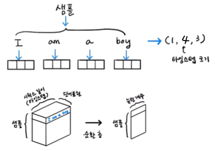

**다층 순환 신경망**

- 케라스의 순환층은 기본적으로 마지막 타임스텝의 은닉 상태만 출력으로 내보냅니다.
- 이는 입력된 시퀀스에서 읽은 모든 정보를 마지막 은닉 상태에 압축하여 전달하는 것처럼 볼 수 있습니다.
- 순환 신경망도 완전 연결 신경망이나 합성곱 신경망처럼 여러 개의 층을 쌓을 수 있습니다.
- 단, 셀의 입력은 샘플마다 타임스텝과 단어 표현으로 이루어진 2차원 배열이어야 합니다. 따라서 마지막 셀을 제외한 다른 모든 셀은 모든 타임스텝의 은닉 상태를 출력해야 합니다.
- 즉, 아래 그림처럼 첫 번째 셀은 모든 타임스텝의 은닉 상태를 출력하고, 두 번째(마지막) 셀은 마지막 타임스텝의 은닉 상태만 출력합니다.

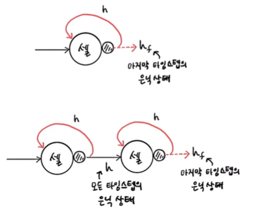

**출력층의 구성**

- 합성곱 신경망과 마찬가지로 순환 신경망도 마지막에는 밀집층(Dense)을 두어 클래스를 분류합니다.
- 다중 분류일 경우에는 출력층에 클래스 개수만큼 뉴런을 두고 소프트맥스(softmax) 활성화 함수를 사용합니다.
- 이진 분류일 경우에는 하나의 뉴런을 두고 시그모이드(sigmoid) 활성화 함수를 사용합니다.

**다중 분류 문제에서 입력 샘플의 크기가 (20, 100)일 경우 하나의 순환층을 사용하는 구조**

1. 샘플은 20개의 타임스텝으로 이루어져 있습니다.
2. 각 타임스텝은 100개의 표현 또는 특성으로 이루어져 있습니다.
3. 순환층을 통과한 은닉 상태의 크기는 셀에 있는 뉴런의 개수가 되므로 `(10, )`입니다.
4. 샘플마다 셀의 출력이 1차원이기 때문에 합성곱 신경망처럼 `Flatten` 클래스로 펼칠 필요 없이 바로 출력층에 연결할 수 있습니다.
5. 3개의 클래스를 가진 다중 분류일 경우를 위해 출력층에 3개의 뉴런과 소프트맥스 활성화 함수를 사용한 예시입니다.

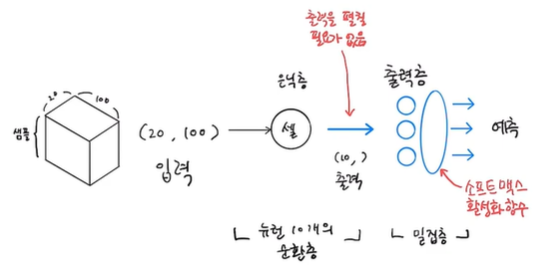

---

### 2. 순환 신경망으로 IMDB 리뷰 분류하기

#### IMDB 리뷰 데이터셋

유명한 인터넷 영화 데이터베이스인 `imdb.com`에서 수집한 리뷰를 감상평에 따라 긍정과 부정으로 분류해 놓은 데이터셋입니다.

> 💡 **자연어 처리 (NLP, Natural Language Processing)**
> - 컴퓨터를 사용해 인간의 언어를 처리하는 분야입니다.
> - 대표적인 세부 분야로는 음성 인식, 기계 번역, 감성 분석 등이 있습니다.
> - IMDB 리뷰를 감상평에 따라 분류하는 작업은 감성 분석에 해당하며, 자연어 처리 분야에서의 훈련 데이터를 흔히 **말뭉치(corpus)**라고 부릅니다.

- 텍스트 데이터의 경우 단어를 숫자 데이터로 바꾸는 일반적인 방법은 데이터에 등장하는 단어마다 고유한 정수를 부여하는 것입니다.

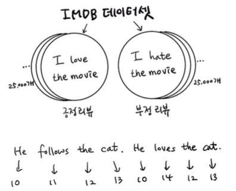

- ‘He’를 10으로 매핑하고 ‘cat’을 13에 매핑하더라도 두 정숫값 사이에는 어떤 크기나 순서 관계도 없습니다.
- 일반적으로 영어 문장은 모두 소문자로 바꾸고 구두점을 삭제한 다음 공백을 기준으로 분리하는데, 이렇게 분리된 단어를 **토큰(token)**이라고 부릅니다.
- 하나의 샘플은 여러 개의 토큰으로 이루어져 있고, 1개의 토큰이 하나의 타임스텝에 해당합니다.

**데이터 불러오기 및 확인**

- `keras.datasets` 패키지 아래 `imdb` 모듈을 임포트한 후, 가장 자주 등장하는 단어 200개만 사용하여 데이터를 불러옵니다.

```python
from tensorflow.keras.datasets import imdb

(train_input, train_target), (test_input, test_target) = imdb.load_data(num_words=200)
print(train_input.shape, test_input.shape)
# 출력 : (25000,) (25000,)
```

- 첫 번째와 두 번째 리뷰의 길이를 출력해 봅니다.

```python
print(len(train_input[0]))
# 출력 : 218
print(len(train_input[1]))
# 출력 : 189
```

- 첫 번째 리뷰에 담긴 내용을 출력해 봅니다. (단어가 정수로 변환되어 있으며, 어휘 사전(200개)에 없는 단어는 모두 `2`로 표시됩니다.)

```python
print(train_input[0])
'''
출력 : [1, 14, 22, 16, 43, 2, 2, 2, 2, 65, 2, 2, 66, 2, 4, 173, 36, 2, 5, 25, 100,
        43, 2, 112, 50, 2, 2, 9, 35, 2, 2, 5, 150, 4, 172, 112, 167, 2, 2, 2, 39, 
        4, 172, 2, 2, 17, 2, 38, 13, 2, 4, 192, 50, 16, 6, 147, 2, 19, 14, 22, 4, 2, 
        2, 2, 4, 22, 71, 87, 12, 16, 43, 2, 38, 76, 15, 13, 2, 4, 22, 17, 2, 17, 12, 
        16, 2, 18, 2, 5, 62, 2, 12, 8, 2, 8, 106, 5, 4, 2, 2, 16, 2, 66, 2, 33, 4, 
        130, 12, 16, 38, 2, 5, 25, 124, 51, 36, 135, 48, 25, 2, 33, 6, 22, 12, 2, 
        28, 77, 52, 5, 14, 2, 16, 82, 2, 8, 4, 107, 117, 2, 15, 2, 4, 2, 7, 2, 5,
        2, 36, 71, 43, 2, 2, 26, 2, 2, 46, 7, 4, 2, 2, 13, 104, 88, 4, 2, 15, 2,
        98, 32, 2, 56, 26, 141, 6, 194, 2, 18, 4, 2, 22, 21, 134, 2, 26, 2, 5, 144,
        30, 2, 18, 51, 36, 28, 2, 92, 25, 104, 4, 2, 65, 16, 38, 2, 88, 12, 16, 2,
        5, 16, 2, 113, 103, 32, 15, 16, 2, 19, 178, 32]
'''
```

- 타깃 데이터를 출력합니다. 타깃값은 `0`(부정)과 `1`(긍정)로 나누어집니다.

```python
print(train_target[:20])
# 출력 : [1 0 0 1 0 0 1 0 1 0 1 0 0 0 0 0 1 1 0 1]
```

- 훈련 세트에서 검증 세트를 20%떼어내어 분리합니다.

```python
from sklearn.model_selection import train_test_split

train_input, val_input, train_target, val_target = train_test_split(
    train_input, train_target, test_size=0.2, random_state=42)
```

- `mean()` 함수와 `median()` 함수를 사용해 리뷰 길이의 평균과 중간값을 구합니다.

```python
import numpy as np

lengths = np.array([len(x) for x in train_input])
print(np.mean(lengths), np.median(lengths))
# 출력 : 239.00925 178.0
```

- `lengths` 배열을 히스토그램으로 표현해 확인해 봅니다.
    - 평균이 중간값보다 높은 이유는 오른쪽 끝에 아주 긴 리뷰 데이터가 일부 있기 때문입니다.
    - 대부분의 리뷰가 짧기 때문에, 여기서는 중간값보다 훨씬 짧은 100개의 단어만 사용하겠습니다.
    - 100개의 단어보다 짧은 리뷰들의 길이를 100에 맞추기 위해서는 패딩(padding) 작업이 필요하며, 패딩을 나타내는 토큰으로는 `0`을 사용합니다.
    
    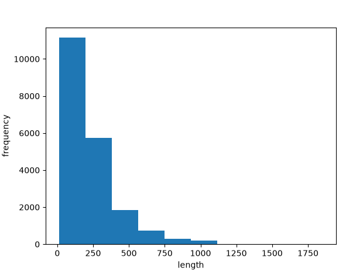
    
**시퀀스 패딩 (Sequence Padding)**

- 시퀀스 데이터의 길이를 맞추는 케라스의 `pad_sequences()` 함수를 사용합니다.
    - `maxlen`에 원하는 길이를 지정하면 이보다 긴 경우는 잘라내고, 짧은 경우는 `0`으로 패딩합니다.

```python
from tensorflow.keras.preprocessing.sequence import pad_sequences

train_seq = pad_sequences(train_input, maxlen=100)
val_seq = pad_sequences(val_input, maxlen=100)
print(train_seq.shape)
# 출력 : (20000, 100)
```

- 기존의 `train_input`은 파이썬 리스트의 배열이었지만, 길이를 100으로 맞춘 `train_seq`는 이제 `(20000, 100)` 크기의 2차원 배열이 되었습니다.

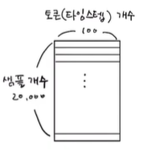

- `pad_sequences()` 함수는 기본적으로 `maxlen`보다 긴 시퀀스의 앞부분을 자릅니다.
    - 일반적으로 시퀀스의 뒷부분에 더 결정적인 정보가 있으리라 기대하기 때문입니다.
    - 만약 뒷부분을 잘라내고 싶다면 `pad_sequences()` 함수의 `truncating` 매개변수 값을 `'post'`로 바꾸면 됩니다.

#### 순환 신경망 만들기

**원-핫 인코딩 (One-Hot Encoding)**

- 토큰을 정수로 변환한 데이터에는 큰 숫자가 더 중요하다는 식의 크기 속성이 없어야 합니다. 정숫값에 있는 크기 속성을 없애고 각 정수를 고유하게 표현하기 위해 **원-핫 인코딩**으로 변경합니다.
        
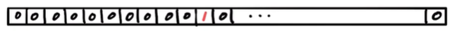
        
- `imdb.load_data()` 함수에서 200개의 단어만 사용하도록 지정했기 때문에 고유한 단어(정숫값 범위 0~199)는 모두 200개입니다. 따라서 원-핫 인코딩을 적용하면 정수 하나마다 모두 200차원의 배열로 변경됩니다.
- 결과적으로 `(20000, 100)` 크기의 `train_seq`가 `(20000, 100, 200)` 크기의 `train_oh`로 바뀝니다. 검증 데이터도 동일하게 변환해 줍니다.
    
```python
from tensorflow import keras

train_oh = keras.utils.to_categorical(train_seq)
val_oh = keras.utils.to_categorical(val_seq)
print(train_oh.shape)
# 출력 : (20000, 100, 200) 
```

**SimpleRNN 모델 구성**

- 샘플 데이터의 크기가 1차원 정수 배열 `(100, )`에서 2차원 배열 `(100, 200)`으로 바뀌었으므로, `Input` 함수의 `shape` 매개변수 값을 `(100, 200)`으로 지정하여 `SimpleRNN` 모델을 만듭니다.

```python
model = keras.Sequential()
# 샘플의 길이가 100이고 원-핫 인코딩 크기가 200이므로 shape=(100, 200)으로 지정합니다.
model.add(keras.layers.Input(shape=(100, 200)))
model.add(keras.layers.SimpleRNN(8))
model.add(keras.layers.Dense(1, activation='sigmoid'))

model.summary()
```
    
**모델 구조 및 파라미터 확인**

- `SimpleRNN`에 전달할 샘플의 크기는 `(100, 200)`이지만, 이 순환층은 마지막 타임스텝의 은닉 상태만 출력하므로 출력 크기는 `(None, 8)`입니다.
- 입력 토큰은 200차원의 원-핫 인코딩 배열입니다. 이 배열이 순환층의 뉴런 8개와 완전히 연결되기 때문에 총 $200 \times 8 = 1,600$개의 가중치가 있습니다.
- 순환층의 은닉 상태는 다시 다음 타임스텝에 사용되기 위해 또 다른 가중치와 곱해집니다. 이 은닉 상태도 순환층의 뉴런과 완전히 연결되기 때문에 $8(\text{은닉 상태 크기}) \times 8(\text{뉴런 개수}) = 64$개의 가중치가 필요합니다.
- 마지막으로 뉴런마다 하나의 절편이 있으므로, 순환층에는 모두 $1,600 + 64 + 8 = 1,672$개의 모델 파라미터가 필요합니다.

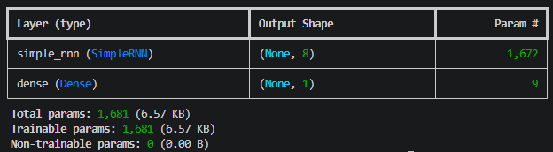

#### 순환 신경망 훈련하기

1. `Adam` 옵티마이저를 사용합니다.
2. 이진 분류 문제이므로 손실 함수로 `'binary_crossentropy'`를 사용합니다.
3. 에포크 횟수를 100으로 늘리고 배치 크기는 64개로 설정하여 훈련합니다.

```python
model.compile(optimizer='adam', loss='binary_crossentropy', metrics=['accuracy'])
checkpoint_cb = keras.callbacks.ModelCheckpoint('best-simplernn-model.keras', save_best_only=True)
early_stopping_cb = keras.callbacks.EarlyStopping(patience=3, restore_best_weights=True)

history = model.fit(train_oh, train_target, epochs=100, batch_size=64, 
                    validation_data=(val_oh, val_target), 
                    callbacks=[checkpoint_cb, early_stopping_cb])
'''
Epoch 1/100
313/313 ━━━━━━━━━━━━━━━━━━━━ 5s 12ms/step - accuracy: 0.5175 - loss: 0.6950 - val_accuracy: 0.5358 - val_loss: 0.6883
...
Epoch 11/100
313/313 ━━━━━━━━━━━━━━━━━━━━ 3s 9ms/step - accuracy: 0.7376 - loss: 0.5355 - val_accuracy: 0.7242 - val_loss: 0.5448
Epoch 12/100
313/313 ━━━━━━━━━━━━━━━━━━━━ 3s 9ms/step - accuracy: 0.7364 - loss: 0.5339 - val_accuracy: 0.7276 - val_loss: 0.5490
'''
```

이 훈련은 열두 번째 에포크에서 조기 종료되었습니다. 검증 세트에 대한 정확도는 약 73% 정도입니다.

- 훈련 손실과 검증 손실을 그래프로 그려 훈련 과정을 살펴보겠습니다.

```python
import matplotlib.pyplot as plt

plt.plot(history.history['loss'], label='train')
plt.plot(history.history['val_loss'], label='val')
plt.xlabel('epoch')
plt.ylabel('loss')
plt.legend()
plt.show()
```

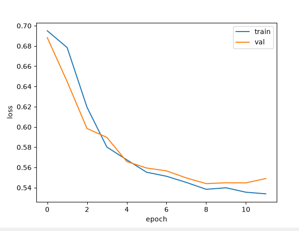

훈련 손실은 꾸준히 감소하고 있지만 검증 손실은 아홉 번째 에포크 이후로 감소가 멈췄습니다.

- 이 작업을 하기 위해서 입력 데이터를 원-핫 인코딩으로 변환했는데, 원-핫 인코딩은 입력 데이터가 엄청나게 커진다는 단점이 있습니다.
- 실제로 확인해 보면 `train_seq` 배열의 크기는 약 8MB 정도인데 반해, `train_oh`의 크기는 약 3.2GB에 달합니다.

```python
print(train_seq.nbytes, train_oh.nbytes)
# 출력 : 8000000 3200000000
```

#### 단어 임베딩을 사용하기

순환 신경망에서 텍스트를 처리할 때 즐겨 사용하는 방법은 **단어 임베딩(Word Embedding)**입니다.

- 단어 임베딩은 각 단어를 고정된 크기의 실수 벡터로 바꾸어 줍니다.
    
    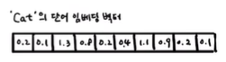
    
- 이런 단어 임베딩으로 만들어진 벡터는 원-핫 인코딩된 벡터보다 훨씬 의미 있는 값으로 채워져 있기 때문에 자연어 처리에서 더 좋은 성능을 내는 경우가 많습니다.
- 또한, 단어 임베딩의 큰 장점은 원-핫 인코딩 변환 없이 **입력으로 정수 데이터를 그대로 받는다**는 것입니다. 메모리를 훨씬 효율적으로 사용할 수 있으므로 이번에는 단어 사전의 크기를 500개로 늘려서 진행해 보겠습니다.

```python
(train_input, train_target), (test_input, test_target) = imdb.load_data(num_words=500)
train_input, val_input, train_target, val_target = train_test_split(
    train_input, train_target, test_size=0.2, random_state=42)
train_seq = pad_sequences(train_input, maxlen=100)
val_seq = pad_sequences(val_input, maxlen=100)

model_emb = keras.Sequential()
model_emb.add(keras.layers.Input(shape=(100,)))
model_emb.add(keras.layers.Embedding(500, 16))
model_emb.add(keras.layers.SimpleRNN(8))
model_emb.add(keras.layers.Dense(1, activation='sigmoid'))

model_emb.summary()
```

- `Embedding` 클래스를 `SimpleRNN` 층 앞에 추가한 두 번째 순환 신경망입니다.
- `train_seq`를 그대로 사용하므로 `Input` 함수에 지정할 입력의 크기는 `(100,)`입니다.
- `Embedding` 클래스의 첫 번째 매개변수(`500`)는 어휘 사전의 크기입니다.
- 두 번째 매개변수(`16`)는 임베딩 벡터의 크기입니다.

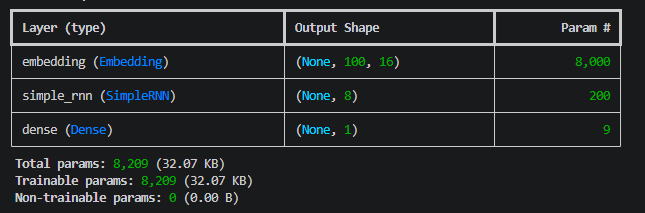

- 임베딩 층은 `(100, )` 크기의 입력을 받아 `(100, 16)` 크기의 출력을 만듭니다.
- `Embedding` 클래스는 500개의 토큰을 각각 크기가 16인 벡터로 변경하기 때문에 총 $500 \times 16 = 8,000$개의 모델 파라미터를 가집니다.
- `SimpleRNN` 층은 임베딩 벡터의 크기가 16이므로 8개의 뉴런과 곱하기 위해 필요한 가중치 $16 \times 8 = 128$개를 가집니다.
- 또한 은닉 상태에 곱해지는 가중치 $8 \times 8 = 64$개가 있습니다.
- 마지막으로 8개의 절편이 있으므로, 이 순환층에 있는 전체 모델 파라미터의 개수는 $128 + 64 + 8 = 200$개입니다.

```python
model_emb.compile(optimizer='adam', loss='binary_crossentropy', metrics=['accuracy'])
checkpoint_cb = keras.callbacks.ModelCheckpoint('best-embedding-model.keras', save_best_only=True)
early_stopping_cb = keras.callbacks.EarlyStopping(patience=3, restore_best_weights=True)

history = model_emb.fit(train_seq, train_target, epochs=100, batch_size=64, 
                        validation_data=(val_seq, val_target), 
                        callbacks=[checkpoint_cb, early_stopping_cb])
'''
Epoch 1/100
313/313 ━━━━━━━━━━━━━━━━━━━━ 4s 9ms/step - accuracy: 0.5463 - loss: 0.6844 - val_accuracy: 0.5738 - val_loss: 0.6702
...
Epoch 7/100
313/313 ━━━━━━━━━━━━━━━━━━━━ 2s 8ms/step - accuracy: 0.7913 - loss: 0.4682 - val_accuracy: 0.7582 - val_loss: 0.5099
...
Epoch 10/100
313/313 ━━━━━━━━━━━━━━━━━━━━ 2s 7ms/step - accuracy: 0.7073 - loss: 0.5772 - val_accuracy: 0.7442 - val_loss: 0.5354
'''
```

- 훈련 손실과 검증 손실을 그래프로 출력해 확인합니다.

```python
plt.plot(history.history['loss'], label='train')
plt.plot(history.history['val_loss'], label='val')
plt.xlabel('epoch')
plt.ylabel('loss')
plt.legend()
plt.show()
```

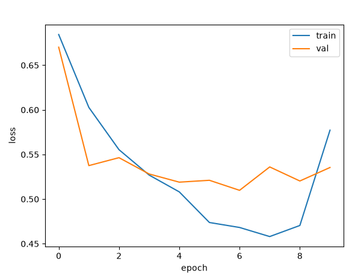

---

### 3. LSTM과 GRU 셀

일반적으로 기본 순환층(`SimpleRNN`)은 시퀀스가 길수록 순환되는 은닉 상태에 담긴 정보가 점차 희석되기 때문에 긴 시퀀스를 학습하기 어렵습니다. 따라서 멀리 떨어져 있는 단어 정보를 인식하는 데 어려움이 있을 수 있어 이를 보완하기 위해 **LSTM**과 **GRU** 셀이 발명되었습니다.

#### LSTM 구조

- **LSTM**은 Long Short-Term Memory의 약자로, 단기 기억을 오래 기억하기 위해 고안되었습니다.
- LSTM 내부에는 입력과 가중치를 곱하고 절편을 더해 활성화 함수를 통과시키는 작은 셀 구조가 여러 개 포함되어 있습니다. 이런 계산 결과는 다음 타임스텝에 재사용됩니다.

1. 기본적인 은닉 상태는 입력과 이전 타임스텝의 은닉 상태를 가중치에 곱한 후 활성화 함수를 통과시켜 다음 은닉 상태를 만듭니다.
2. 아래 그림에서 파란색 원은 `tanh` 함수, 주황색 원은 `시그모이드` 함수, $\times$는 곱셈 기호, $+$는 덧셈 기호를 나타냅니다. LSTM에는 순환되는 상태가 **은닉 상태($h$)**와 **셀 상태($c$)** 2개입니다. 은닉 상태와 달리 셀 상태는 다음 층으로 전달되지 않고 LSTM 셀 내부에서만 순환되는 값입니다.
3. 먼저 입력과 은닉 상태($h$)를 가중치($w_f$)에 곱한 후 시그모이드 함수를 통과시키고, 이를 이전 타임스텝의 셀 상태와 곱하여($\times$) 정보를 제어합니다. 이후 갱신된 셀 상태는 오른쪽에서 `tanh` 함수를 통과하여 출력 게이트($w_o$를 통과한 값)와 곱해져 새로운 은닉 상태($h$)를 만듭니다.
4. 즉, LSTM은 작은 셀을 여러 개 포함하고 있는 큰 셀과 같으며, 곱해지는 가중치($w_o, w_f$ 등)가 모두 다르므로 각각의 작은 셀은 서로 다른 기능을 위해 훈련됩니다.
5. 여기에 2개의 작은 셀이 더 추가되어 셀 상태를 만드는 데 기여합니다. 입력과 은닉 상태($h$)를 각기 다른 가중치($w_i, w_j$)에 곱한 다음, 하나는 시그모이드 함수를 통과하고 다른 하나는 `tanh` 함수를 통과합니다. 그다음 두 결과를 곱한 후($\times$) 이전 셀 상태와 더하게 되며($+$), 이 결과가 최종적인 다음 셀 상태($c$)가 됩니다.
6. 세 군데의 곱셈을 왼쪽부터 차례대로 **삭제 게이트(forget gate)**, **입력 게이트(input gate)**, **출력 게이트(output gate)**라고 부릅니다.
    - **삭제 게이트:** 셀 상태에 있는 정보를 제거하는 역할을 합니다.
    - **입력 게이트:** 새로운 정보를 셀 상태에 추가하는 역할을 합니다.
    - **출력 게이트:** 셀 상태가 다음 은닉 상태로 출력되는 양을 제어합니다.

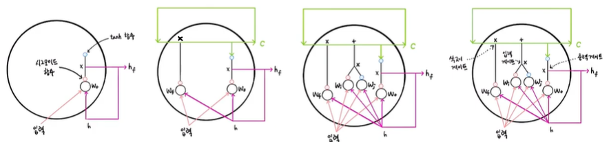

#### LSTM 신경망 훈련하기

`SimpleRNN` 클래스의 순환층 모델 파라미터 개수는 200개였지만, `LSTM` 셀에는 작은 셀이 4개 있으므로 파라미터 개수가 정확히 4배로 늘어 800개가 됩니다.

```python
model_lstm = keras.Sequential()
model_lstm.add(keras.layers.Input(shape=(100,)))
model_lstm.add(keras.layers.Embedding(500, 16))
model_lstm.add(keras.layers.LSTM(8))
model_lstm.add(keras.layers.Dense(1, activation='sigmoid'))

model_lstm.summary()
```

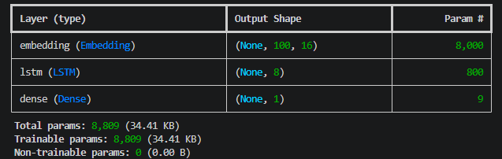

모델을 컴파일하고 훈련을 진행합니다.

```python
model_lstm.compile(optimizer='adam', loss='binary_crossentropy', metrics=['accuracy'])
checkpoint_cb = keras.callbacks.ModelCheckpoint('best-lstm-model.keras', save_best_only=True)
early_stopping_cb = keras.callbacks.EarlyStopping(patience=3, restore_best_weights=True)

history = model_lstm.fit(train_seq, train_target, epochs=100, batch_size=64,
                         validation_data=(val_seq, val_target), 
                         callbacks=[checkpoint_cb, early_stopping_cb])
'''
Epoch 1/100
313/313 ━━━━━━━━━━━━━━━━━━━━ 6s 15ms/step - accuracy: 0.6791 - loss: 0.5907 - val_accuracy: 0.7730 - val_loss: 0.4822
...
Epoch 7/100
313/313 ━━━━━━━━━━━━━━━━━━━━ 5s 14ms/step - accuracy: 0.8204 - loss: 0.3947 - val_accuracy: 0.8072 - val_loss: 0.4197
...
Epoch 10/100
313/313 ━━━━━━━━━━━━━━━━━━━━ 5s 15ms/step - accuracy: 0.8242 - loss: 0.3805 - val_accuracy: 0.7986 - val_loss: 0.4276
'''
```

검증 세트에 대한 정확도가 약 80% 이상으로 `SimpleRNN` 클래스를 사용했을 때보다 뚜렷하게 향상되었습니다.

- 훈련 손실과 검증 손실 그래프를 확인해 봅니다.

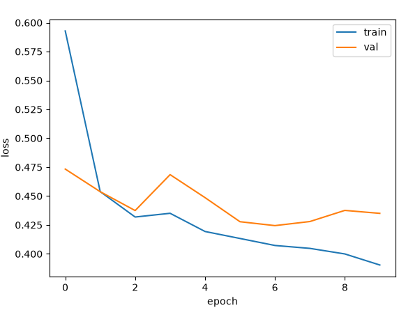

#### 순환층에 드롭아웃 적용하기

과대적합을 억제하기 위해 순환층 자체에 드롭아웃을 적용할 수 있습니다. `LSTM` 클래스의 `dropout` 매개변수를 `0.2`로 지정하여 훈련해 보겠습니다.

```python
model_dropout = keras.Sequential()
model_dropout.add(keras.layers.Input(shape=(100,)))
model_dropout.add(keras.layers.Embedding(500, 16))
model_dropout.add(keras.layers.LSTM(8, dropout=0.2))
model_dropout.add(keras.layers.Dense(1, activation='sigmoid'))

model_dropout.compile(optimizer='adam', loss='binary_crossentropy', metrics=['accuracy'])
checkpoint_cb = keras.callbacks.ModelCheckpoint('best-dropout-model.keras', save_best_only=True)
early_stopping_cb = keras.callbacks.EarlyStopping(patience=3, restore_best_weights=True)

history = model_dropout.fit(train_seq, train_target, epochs=100, batch_size=64,
                            validation_data=(val_seq, val_target), 
                            callbacks=[checkpoint_cb, early_stopping_cb])
```

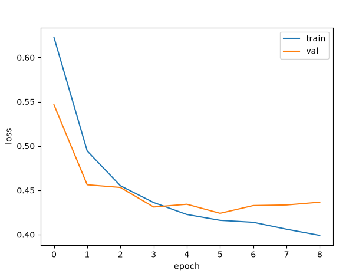

훈련 손실이 줄어드는 속도를 조금 억제했지만, 검증 손실이 이전보다 크게 나아지지는 않았습니다.

#### 2개의 층을 연결하기

순환층의 은닉 상태는 기본적으로 샘플의 마지막 타임스텝에 대한 은닉 상태만 다음 층으로 전달합니다. 하지만 순환층을 여러 개 쌓게 되면 다음 순환층에도 2차원 형태의 순차 데이터가 입력되어야 합니다. 따라서 앞쪽의 순환층은 모든 타임스텝에 대한 은닉 상태를 출력해야 하고, 오직 가장 마지막 순환층만 마지막 타임스텝의 은닉 상태를 출력해야 합니다.

케라스의 순환층에서 모든 타임스텝의 은닉 상태를 출력하려면 마지막을 제외한 다른 모든 순환층에서 `return_sequences` 매개변수를 `True`로 지정하면 됩니다.

```python
model_2lstm = keras.Sequential()
model_2lstm.add(keras.layers.Input(shape=(100,)))
model_2lstm.add(keras.layers.Embedding(500, 16))
model_2lstm.add(keras.layers.LSTM(8, dropout=0.2, return_sequences=True))
model_2lstm.add(keras.layers.LSTM(8, dropout=0.2))
model_2lstm.add(keras.layers.Dense(1, activation='sigmoid'))

model_2lstm.summary()
```

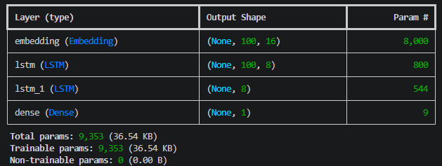

첫 번째 LSTM 층이 모든 타임스텝(100개)의 은닉 상태를 출력하기 때문에 출력 크기가 `(None, 100, 8)`로 표시되었습니다. 이에 반해 두 번째 LSTM 층의 출력 크기는 마지막 타임스텝의 은닉 상태만을 출력하기 때문에 `(None, 8)`입니다.

```python
model_2lstm.compile(optimizer='adam', loss='binary_crossentropy', metrics=['accuracy'])
checkpoint_cb = keras.callbacks.ModelCheckpoint('best-2lstm-model.keras', save_best_only=True)
early_stopping_cb = keras.callbacks.EarlyStopping(patience=3, restore_best_weights=True)

history = model_2lstm.fit(train_seq, train_target, epochs=100, batch_size=64, 
                          validation_data=(val_seq, val_target), 
                          callbacks=[checkpoint_cb, early_stopping_cb])
'''
Epoch 10/100
313/313 ━━━━━━━━━━━━━━━━━━━━ 10s 31ms/step - accuracy: 0.8187 - loss: 0.3934 - val_accuracy: 0.8148 - val_loss: 0.4149
...
Epoch 14/100
313/313 ━━━━━━━━━━━━━━━━━━━━ 10s 33ms/step - accuracy: 0.8294 - loss: 0.3756 - val_accuracy: 0.8140 - val_loss: 0.4102
...
Epoch 17/100
313/313 ━━━━━━━━━━━━━━━━━━━━ 10s 32ms/step - accuracy: 0.8377 - loss: 0.3642 - val_accuracy: 0.8158 - val_loss: 0.4183
'''
```

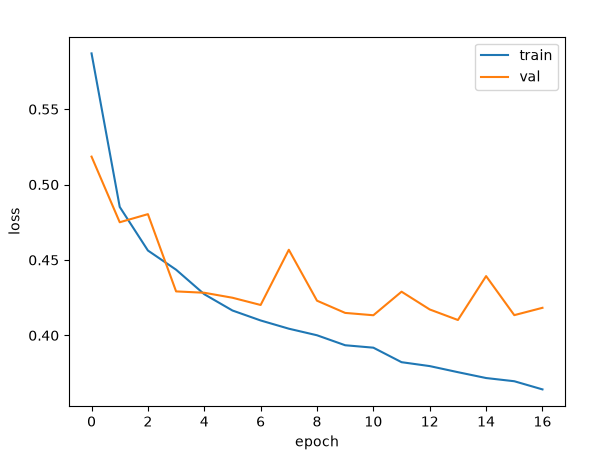

#### GRU 구조

**GRU**는 Gated Recurrent Unit의 약자입니다. 이 셀은 LSTM을 간소화한 버전으로, LSTM처럼 셀 상태를 별도로 계산하지 않고 은닉 상태 하나만 포함하고 있습니다.

- GRU 셀에는 은닉 상태와 입력에 가중치를 곱하고 절편을 더하는 작은 셀이 3개 들어 있습니다.
- 2개는 시그모이드 활성화 함수를 사용하고, 하나는 `tanh` 활성화 함수를 사용합니다.
- 맨 왼쪽에서 $w_z$를 사용하는 셀의 출력이 은닉 상태에 바로 곱해져 **삭제 게이트** 역할을 수행합니다.
- 이와 똑같은 출력을 1에서 뺀 다음($1-z$), 가장 오른쪽 $w_g$를 사용하는 셀의 출력에 곱합니다. 이는 **입력되는 정보를 제어**하는 역할을 수행합니다.
- 가운데 $w_r$을 사용하는 셀에서 출력된 값은 $w_g$ 셀이 사용할 **이전 은닉 상태의 정보를 제어**합니다.
    
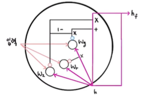
    
**GRU 모델 구성 및 파라미터 계산**

```python
model_gru = keras.Sequential()
model_gru.add(keras.layers.Input(shape=(100,)))
model_gru.add(keras.layers.Embedding(500, 16))
model_gru.add(keras.layers.GRU(8))
model_gru.add(keras.layers.Dense(1, activation='sigmoid'))

model_gru.summary()
```

- GRU 셀에는 3개의 작은 셀이 있고, 각 작은 셀에는 입력과 은닉 상태에 곱하는 가중치와 절편이 있습니다.
- 입력에 곱하는 가중치는 $16 \times 8 = 128$개이고, 은닉 상태에 곱하는 가중치는 $8 \times 8 = 64$개입니다.
- 절편은 뉴런마다 하나씩이므로 8개입니다. 모두 더하면 작은 셀 하나당 $128 + 64 + 8 = 200$개입니다.
- 이런 작은 셀이 3개이므로 총 600개의 모델 파라미터가 필요할 것 같지만, `summary()` 메서드의 출력은 `624`개입니다.

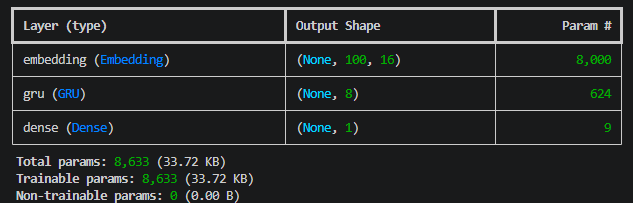

- 그 이유는 케라스(TensorFlow)에 구현된 GRU 셀의 내부 계산 방식이 아래 그림과 같이 약간 다르게 구현되어 있기 때문입니다.
    
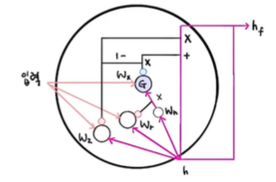
    
- 달라지는 부분은 $G$로 표시된 작은 셀에 들어가는 입력 부분입니다. 첫 번째 이론 그림에서는 가운데 셀($R$)의 출력과 은닉 상태가 먼저 곱해진 후 $G$ 셀에 입력되었습니다.
- 하지만 케라스의 구현(두 번째 그림)에서는 은닉 상태가 먼저 별도의 가중치와 곱해진 다음 가운데 셀의 출력과 곱해집니다. 그래서 이전에는 입력과 은닉 상태에 곱해지는 가중치를 통틀어 $w_g$로 표기했지만, 이 그림에서는 입력에 곱해지는 $w_g$와 은닉 상태에 곱해지는 $w_h$로 나누었습니다.
- 이렇게 나누어 계산하면 은닉 상태에 곱해지는 가중치($w_h$)를 위한 절편이 별도로 필요해집니다. 따라서 3개의 작은 셀마다 은닉 상태를 위한 절편(뉴런 8개분)이 하나씩 더 추가되므로 총 $8 \times 3 = 24$개의 모델 파라미터가 더해집니다. 결과적으로 GRU 층의 총 모델 파라미터 개수는 $600 + 24 = 624$개가 됩니다.

**GRU 신경망 훈련하기**

```python
model_gru.compile(optimizer='adam', loss='binary_crossentropy', metrics=['accuracy'])
checkpoint_cb = keras.callbacks.ModelCheckpoint('best-gru-model.keras', save_best_only=True)
early_stopping_cb = keras.callbacks.EarlyStopping(patience=3, restore_best_weights=True)

history = model_gru.fit(train_seq, train_target, epochs=100, batch_size=64, 
                        validation_data=(val_seq, val_target), 
                        callbacks=[checkpoint_cb, early_stopping_cb])
'''
Epoch 11/100
313/313 ━━━━━━━━━━━━━━━━━━━━ 7s 22ms/step - accuracy: 0.8203 - loss: 0.3965 - val_accuracy: 0.8128 - val_loss: 0.4135
...
Epoch 15/100
313/313 ━━━━━━━━━━━━━━━━━━━━ 7s 21ms/step - accuracy: 0.8289 - loss: 0.3798 - val_accuracy: 0.8164 - val_loss: 0.4059
...
Epoch 18/100
313/313 ━━━━━━━━━━━━━━━━━━━━ 7s 22ms/step - accuracy: 0.8326 - loss: 0.3704 - val_accuracy: 0.8142 - val_loss: 0.4119                      
'''
```

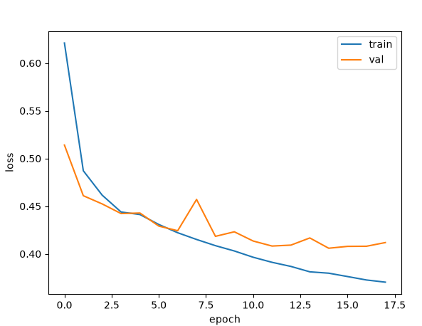

---
*이미지 출처 : [https://gaga-kim.tistory.com/](https://gaga-kim.tistory.com/)*