# Unsupervised Learning

---

## 비지도 학습

- 타깃이 없을 때 사용하는 머신러닝 알고리즘

### 비슷한 샘플끼리 모으기

넘파이에서 npy 파일 로드

```python
import numpy as np
np.load()
```

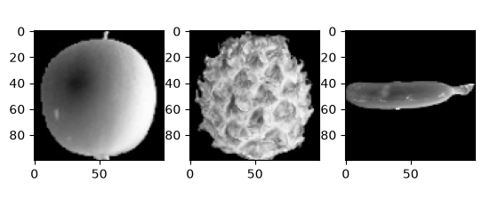

0에 가까울수록 검게 나타나고 255에 가까울수록 밝습니다.

<aside>
💡

알고리즘은 어떤 출력을 만들기 위해 곱셈, 덧셈을 합니다.

픽셀값이 0이면 출력도 0이되어 의미가 없기 때문에 높은 값을 출력해 의미를 부여하기 좋게 만듭니다.

</aside>

#### 픽셀값 분석하기

1. 배열 계산을 위해 100x100 이미지를 1차원 배열로 변경
2. 각 샘플의 평균값을 구하기 위해 axis=1로 지정한 다음 각 샘플의 픽셀 평균 값 계산
3. 사과, 파인애플, 바나나 샘플 100개에 대한 픽셀 평균값 계산 후 히스토그램 생성

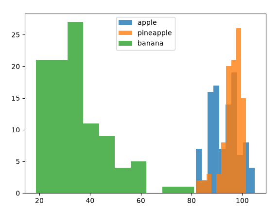

사과와 파인애플은 많이 겹쳐있어 픽셀값만으로는 구분하기 쉽지 않습니다.

- 샘플의 평균값이 아닌 픽셀의 평균값을 비교

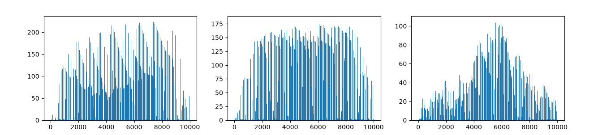

순서대로 사과, 파인애플, 바나나 그래프

- 픽셀 평균값을 100x100 크기로 바꿔서 이미지처럼 출력하여 비교

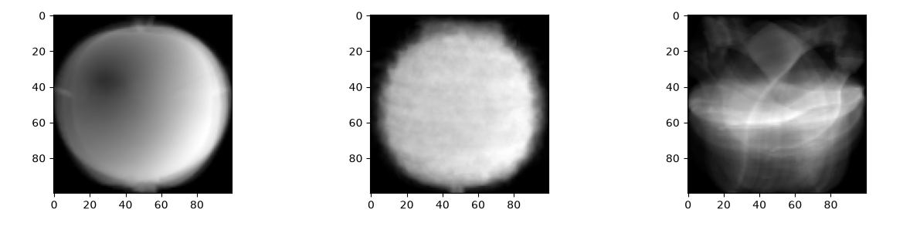

세 과일은 픽셀 위치에 따라 값의 크기가 차이납니다.

#### 평균값과 가까운 사진 고르기

- 사과 사진의 평균값과 가장 가까운 사진 고르기
    1. 모든 샘플에서 apple_mean을 뺀 절대값의 평균 계산하기
    2. 해당 값이 가장 작은 순서대로 100개 고르기 (apple_mean과 오차가 가장 작은 샘플 100개)
    
    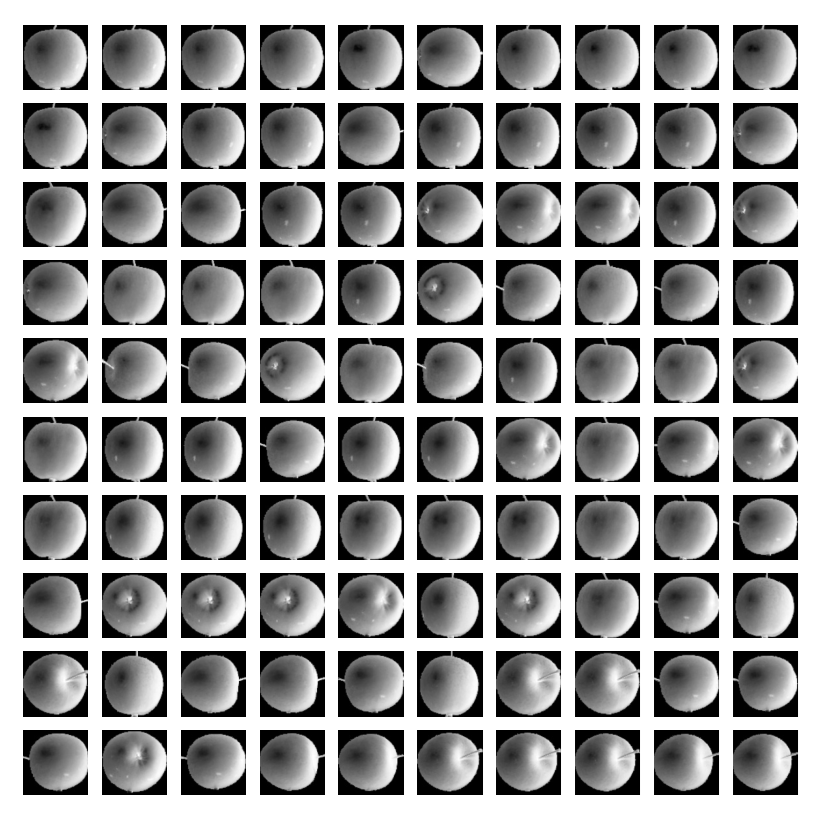
    
- 군집
    - 비슷한 샘플끼리 그룹으로 모으는 작업
    - 군집 알고리즘에서 만든 그룹 : **클러스터**

### k-평균(KMeans)

- 평균 값을 자동으로 찾아줍니다
    - 평균값이 클러스터의 중심에 위치하기 때문에 **클러스터 중심** 또는 **센트로이드**라고 부릅니다.

#### k-평균 알고리즘

1. 무작위로 k개의 클러스터 중심을 정합니다
2. 각 샘플에서 가장 가까운 클러스터 중심을 찾아 해당 클러스터의 햄플로 지정
3. 클러스터에 속한 샘플의 평균값으로 클러스터 중심을 변경
4. 클러스터 중심에 변화가 없을 때까지 2번으로 돌아가 반복
- k-평균 모데을 훈련하기 위해 3차원 배열을 2차원 배열로 변경합니다.

```python
fruits = np.load('fruits_300.npy')
# 3차원 배열 -> 2차원 배열
fruits_2d = fruits.reshape(-1, 100*100)
```

- k-평균 알고리즘은 비지도 학습이므로fit() 메서드에서 타깃 데이터를 사용하지 않습니다.

```python
km = KMeans(n_clusters=3, random_state=42)
km.fit(fruits_2d)
```

- 군집된 결과는 KMeans 클래스 객체의 labels_ 속성에 저장됩니다.
- n_clusters = 3으로 지정했기 때문에 labels_ 배열의 값은 0, 1, 2 중 하나입니다.

```python
print(km.labels_)
```

출력

[2 2 2 2 2 0 2 2 2 2 2 2 2 2 2 2 2 2 0 2 2 2 2 2 2 2 0 2 2 2 2 2 2 2 2 2 2
 2 2 2 2 2 0 2 0 2 2 2 2 2 2 2 0 2 2 2 2 2 2 2 2 2 0 0 2 2 2 2 2 2 2 2 0 2
 2 2 2 2 2 2 2 2 2 2 2 2 2 2 2 2 2 0 2 2 2 2 2 2 2 2 0 0 0 0 0 0 0 0 0 0 0
 0 0 0 0 0 0 0 0 0 0 0 0 0 0 0 0 0 0 0 0 0 0 0 0 0 0 0 0 0 0 0 0 0 0 0 0 0
 0 0 0 0 0 0 0 0 0 0 0 0 0 0 0 0 0 0 0 0 0 0 0 0 0 0 0 0 0 0 0 0 0 0 0 0 0
 0 0 0 0 0 0 0 0 0 0 0 0 0 0 0 1 1 1 1 1 1 1 1 1 1 1 1 1 1 1 1 1 1 1 1 1 1
 1 1 1 1 1 1 1 1 1 0 1 1 1 1 1 1 1 1 1 1 1 1 1 1 1 1 1 1 1 1 1 1 1 1 1 1 1
 1 1 1 1 1 1 1 1 1 1 1 1 1 1 0 1 1 1 1 1 1 1 1 1 1 1 1 1 1 1 1 1 1 1 1 1 1
 1 1 1 1]

- 실제 레이블 0, 1, 2로 모은 샘플의 개수

```python
print(np.unique(km.labels_, return_counts=True))
```

출력

(array([0, 1, 2], dtype=int32), array([112,  98,  90]))

- 3차원 배열을 입력받아 가로로 10개씩 이미지를 출력

```python
def draw_fruits(arr, ratio = 1):
    n = len(arr)
    # 한 줄에 10개씩 이미지 그림
    # 샘플 개수를 10으로 나누어 전체 행 개수 계산
    rows = int(np.ceil(n/10))
    # 행이 1개면 열의 개수는 샘플 개수. 그렇지 않으면 10개
    cols = n if rows < 2 else 10
    fig, axs = plt.subplots(rows, cols, figsize = (cols*ratio, rows*ratio), squeeze=False)
    for i in range(rows):
        for j in range(cols):
            if i*10 + j < n: # n개 까지만 그림
                axs[i, j].imshow(arr[i*10 + j], cmap = 'gray')
            axs[i, j].axis('off')
    plt.show()
    
draw_fruits(fruits[km.labels_==0])
draw_fruits(fruits[km.labels_==1])
draw_fruits(fruits[km.labels_==2])
```

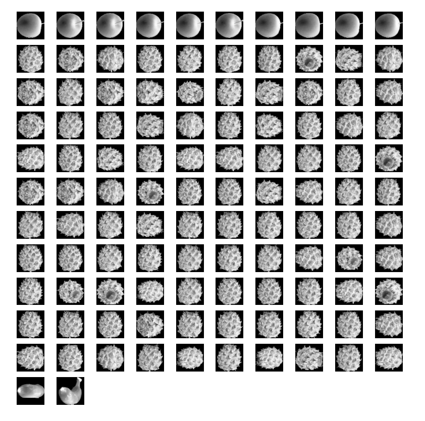

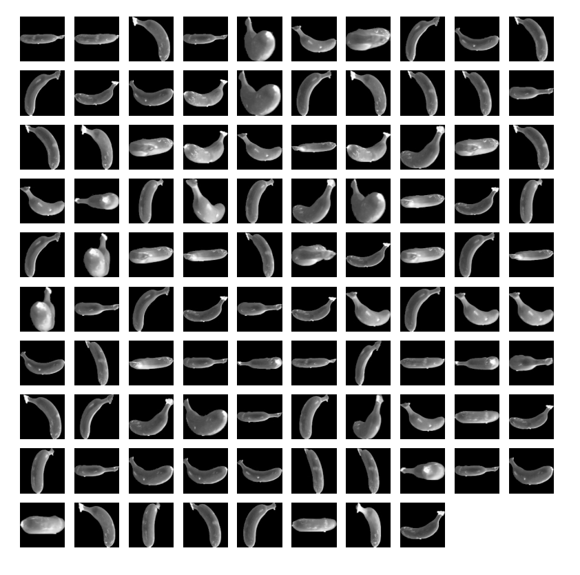

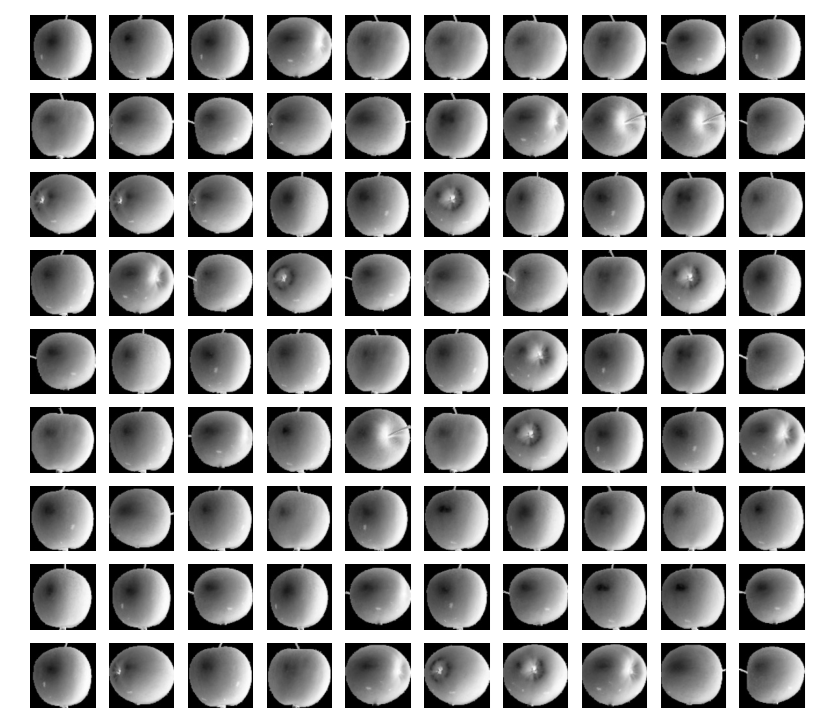

#### 클러스터 중심

- cluster_centers_ : KMeans 클래스가 최종적으로 찾은 클러스터 중심
- 해당 배열은 fruits_2d 샘플의 클러스터 중심이기 때문에 각 중심을 이미지로 출력하려면 100 x 100 크기의 2차원 배열로 바꿔야 합니다.

```python
draw_fruits(km.cluster_centers_.reshape(-1, 100, 100), ratio=3)
```

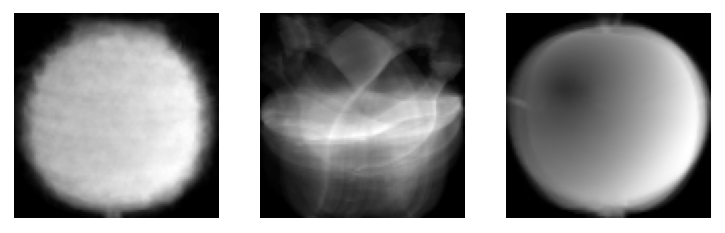

#### 최적의 K 찾기

- **엘보우** 방법
    - 클러스터 개수를 늘려가면서 이너셔의 변화를 관찰하여 최적의 클러스터 개수를 찾는 방법
- **이너셔**
    - 클러스터의 샘플이 얼마나 가깝게 있는지를 나타내는 값

```python
inertia = []
for k in range(2, 7):
    km = KMeans(n_clusters=k, n_init='auto', random_state=42)
    km.fit(fruits_2d)
    inertia.append(km.inertia_)
plt.plot(range(2, 7), inertia)
plt.xlabel('k')
plt.ylabel('inertia')
plt.show()
```

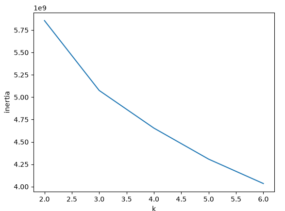

 k-평균 알고리즘은 사전에 클러스터 개수를 미리 지정해야합니다. 

최적의 클러스터 개수 k를 알아내는 한가지 방법은 클러스터가 얼마나 밀집되어 있는지 나타내는 이너셔를 사용하는 것입니다.

이너셔가 더 이상 크게 줄어들지 않는다면 클러스터 개수를 더 늘리는 것은 효과가 없습니다.

### 주성분 분석

#### 차원과 차원 축소

- 머신러닝의 차원
    
    과일 사진의 10,000개의 픽셀 = 10,000개의 특성 = 10,000개의 차원
    
- 차원 축소
    - 데이터를 가장 잘 나타내는 일부 특성을 선택하여 데이터 크기를 줄인다.
    - 지도 학습 모델의 성능을 향상시킬 수 있다.
- 줄어든 차원에서 다시 원본 차원으로 되돌릴 수 있습니다.

#### 주성분 분석 (PCA)

- 주성분 분석(PCA)은 데이터에 있는 분산이 큰 방향을 찾는 것으로 이해할 수 있습니다.
    
    분산 : 데이터가 널리 퍼져있는 정도
    

#### PCA 클래스

- 10,000개의 픽셀 특성을 **50개의 주성분**으로 압축

```python
pca = PCA(n_components=0.5)
pca.fit(fruits_2d)
print(pca.n_components_)
```

출력

(50, 10000)

배열의 첫 번째 차원이 50입니다. (50개의 주성분을 찾음)

- 원본 데이터와 차원이 같으므로 주성분은 100x100 크기의 이미지처럼 출력해 볼 수 있습니다.

```python
draw_fruits(pca.components_.reshape(-1, 100, 100))
```


- 주성분을 찾았으므로 특성의 개수를 10,000개에서 5개로 줄일 수 있습니다.
    - 원본 데이터를 각 주성분으로 분해하는 것으로 생각할 수 있습니다.

```python
fruits_pca = pca.transform(fruits_2d)
print(fruits_pca.shape)
```

출력

(300, 50)

#### 원본 데이터 재구성

```python
fruits_inverse = pca.inverse_transform(fruits_pca)
print(fruits_inverse.shape)
```

출력

(300, 10000)

특성을 50개로 줄이면서 발생한 손실을 감수하고도 원본 크기로 복원할 수 있습니다.

```python
fruits_reconstruct = fruits_inverse.reshape(-1, 100, 100)
for start in [0, 100, 200]:
    draw_fruits(fruits_reconstruct[start:start+100])
    print("\n")
```

#### 설명도니 분산

```python
plt.plot(pca.explained_variance_ratio_)
plt.show()
```


처음 10개의 주성분이 대부분의 분산을 표현하고 있습니다.

#### 다른 알고리즘과 함께 사용하기

- 로지스틱 회귀를 사용하기 위한 타깃 데이터 생성

```python
target = np.array([0]*100 + [1]*100 + [2]*100)
```

- 설명된 분산의 50%에 달하는 주성분을 찾는 PCA 모델

```python
pca = PCA(n_components=0.5)
pca.fit(fruits_2d)
print(pca.n_components_)
```

출력

2

- 2개의 특성만 사용하고도 교차 검증의 결과가 좋을지 확인해보기

```python
scores = cross_validate(lr, fruits_pca, target)
print(np.mean(scores['test_score']))
print(np.mean(scores['fit_time']))
```

출력

0.99
0.036719989776611325

2개의 특성을 사용했을 뿐인데도 99%의 정확도 달성

- 차원 축소된 데이터를 사용해 k-평균 알고리즘으로 클러스트 찾아보기

```python
km = KMeans(n_clusters=3, random_state=42)
km.fit(fruits_pca)
print(np.unique(km.labels_, return_counts=True))
```

출력

(array([0, 1, 2], dtype=int32), array([110,  99,  91]))

- KMeans가 찾은 레이블을 사용해 과일 이미지 출력

```python
for label in range(0, 3):
    draw_fruits(fruits[km.labels_ == label])
    print("\n")
```

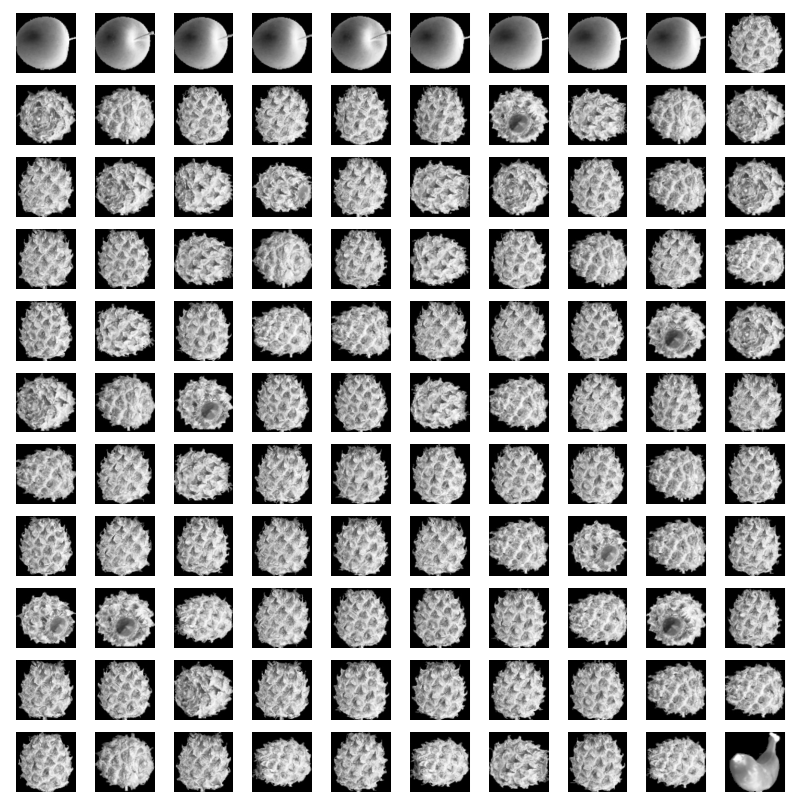

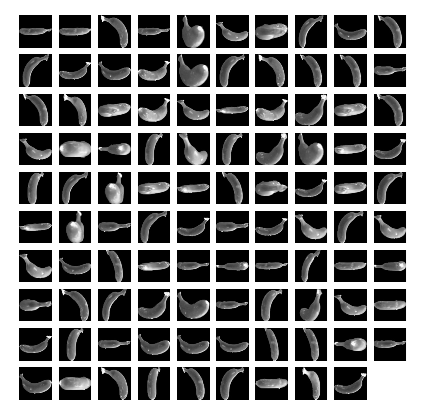

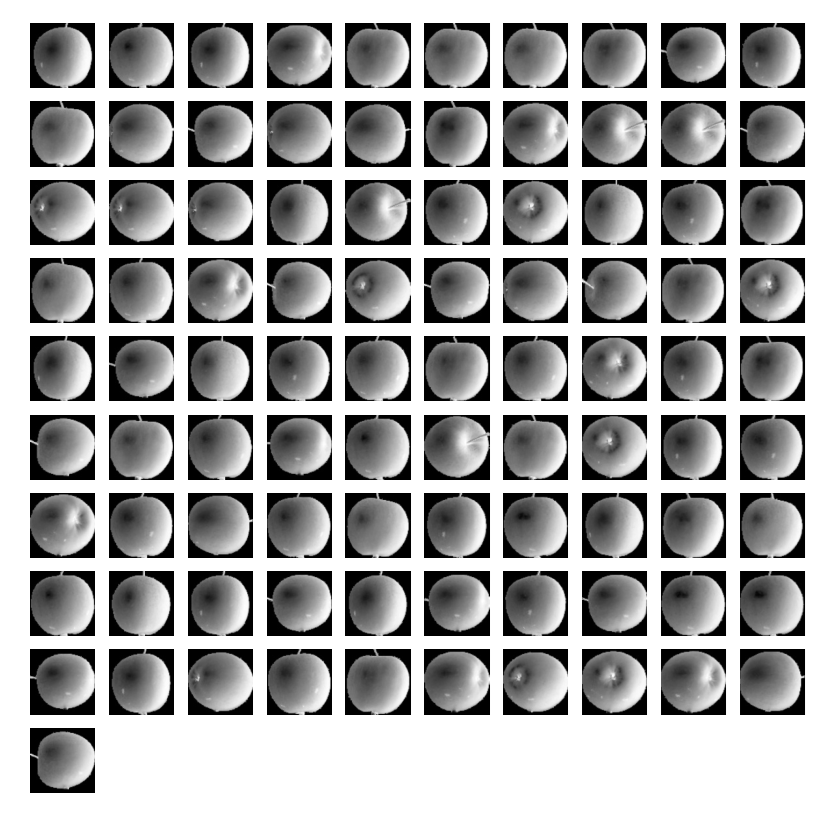

- 훈련 데이터 차원을 줄이면 시각화라는 장점을 얻을 수 있습니다.

```python
for label in range(0, 3):
    data = fruits_pca[km.labels_ ==label]
    plt.scatter(data[:,0], data[:,1])
plt.legend(['apple','banana','pineapple'])
plt.show()
```

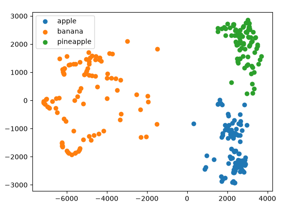
