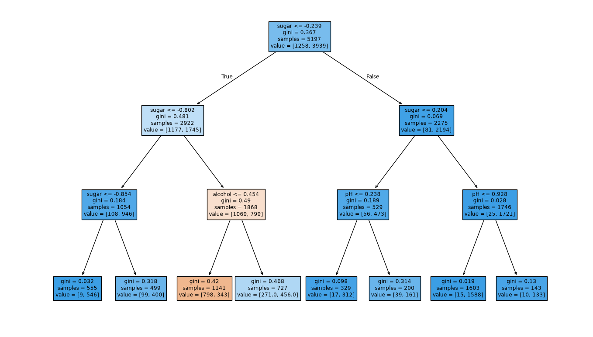

# DecisionTree

---

### DataFrame 메서드

- `info()`
    - 데이터프레임의 각 열의 데이터 타입과 누락된 데이터(결측치)가 있는지 확인
- `describe()`
    - 수치형 열에 대한 간략한 기술통계량 출력 (최소, 최대, 평균, 표준편차, 사분위수 등)

### 사분위수

- 데이터를 오름차순 순서대로 4등분 한 값 (25%, 50%, 75%)
- 2사분위수 ⇒ 중간값(Median)
    - 데이터 개수가 짝수개일 때 ⇒ 가운데 2개 값의 평균 사용

### train_test_split(test_size=0.2)

전체 데이터의 20%로 테스트 세트 구성 (기본값은 25%)

### 결정 트리

gini (지니 불순도)

`DecisionTreeClassifier` 클래스의 `criterion` 매개변수의 기본값이 `'gini'`이다.

- `criterion` 매개변수
    - 노드에서 데이터를 분할할 기준을 정하는 것
    
    $$\text{지니 불순도} = 1 - (\text{음성 클래스 비율}^2 + \text{양성 클래스 비율}^2)$$
    
    - 순수 노드(한 클래스만 존재)일 때 0, 두 클래스 비율이 정확히 반반(0.5)일 때 0.5로 최댓값을 가짐.
    
- 부모와 자식 노드 사이의 불순도 차이를 **정보 이득(Information Gain)**이라고 하며, 정보 이득이 최대가 되도록 노드를 분할한다.

    $$\text{정보 이득} = \text{부모의 불순도} - \sum \left( \frac{\text{자식 노드 샘플 수}}{\text{부모 노드 샘플 수}} \times \text{자식의 불순도} \right)$$

- 엔트로피 불순도 (`criterion='entropy'`)
    - 지니 불순도처럼 제곱이 아니라 밑이 2인 로그를 사용하여 곱함

    $$-\text{음성 클래스 비율} \times \log_2(\text{음성 클래스 비율}) - \text{양성 클래스 비율} \times \log_2(\text{양성 클래스 비율})$$

가지치기(`max_depth`)

- 트리가 끝까지 자라면 훈련 세트에 과대적합되므로 트리의 최대 깊이를 지정해 성장을 제한함
- 주요 가지치기 매개변수:
    - `max_depth`: 트리의 최대 깊이 제한
    - `min_samples_split`: 노드를 분할하기 위한 최소 샘플 수 (기본값 2, 2 이상의 정수여야 함)
    - `min_impurity_decrease`: 노드를 분할하기 위한 불순도 최소 감소량 지정



결정 트리는 특성 값의 크기 자체가 아니라 대소 비교로 노드를 나누기 때문에 **표준화 전처리 과정이 필요 없다.**


## 교차 검증과 그리드 서치

---

### 검증 세트

테스트 세트로 일반화 성능을 측정하기 전에, 전체 데이터 중 20%를 테스트 세트로 만들고 나머지 80%의 훈련 세트에서 20%를 다시 떼어내 검증 세트로 만든다.


### 교차 검증

1. 검증 세트를 떼어 내어 평가하는 과정을 $k$번 반복
2. 이 점수를 평균하여 최종 검증 점수 획득

<aside>
💡

**3-폴드 교차 검증**

- 훈련 세트를 세 부분으로 나눠서 교차 검증을 수행하는 것
- 보통 5, 10-폴드 교차 검증 많이 사용 (`cross_validate` 기본값은 5-폴드)
</aside>

교차 검증을 할 때 훈련 세트를 섞어야 하고 그를 위해 분할기(Splitter)를 지정해야 한다. (`cross_validate`는 기본적으로 훈련 세트를 섞지 않음)

- 회귀 모델일 경우 : `KFold` (`cross_validate` 기본)
- 분류 모델일 경우 : 타깃 클래스를 골고루 나누기 위해 `StratifiedKFold` 사용
- *참고: 검증 점수 외에 훈련 세트 점수도 함께 비교하려면 `return_train_score=True` 지정 필수.*

```python
# 훈련 세트 섞은 후 10-폴드 교차 검증
# n_splits 매개변수는 몇(k) 폴드 교차 검증할지 정함
splitter = StratifiedKFold(n_splits=10, shuffle=True, random_state=42)  
scores = cross_validate(dt, train_input, train_target, cv=splitter)
print(np.mean(scores['test_score']))
